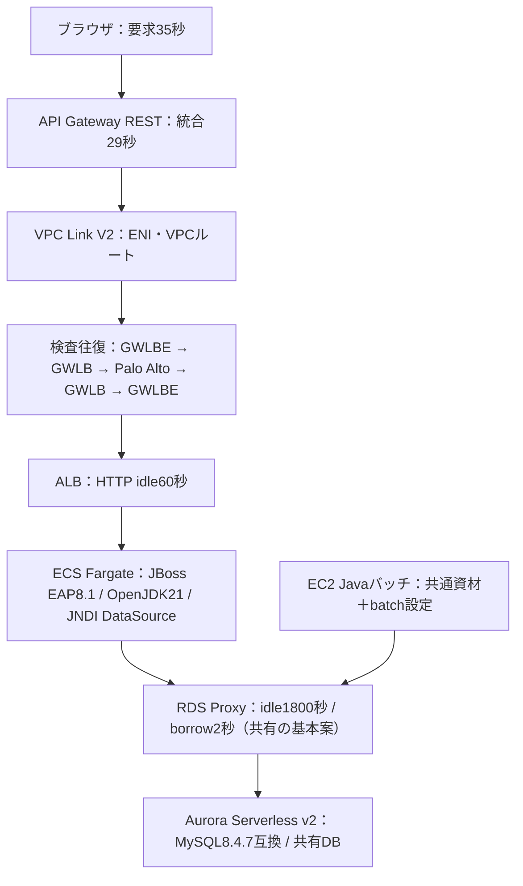

# AWS・Java・MySQL タイムアウト設計詳解

オンライン／Javaバッチ／共有Aurora Serverless v2 ― 既定値と推奨初期値

確認日：**2026-10-11（JST）**。要件未定のため、本構成向けの推奨初期値を仮定つきで示します。

対応Excel：[AWS_Timeout_Design_2026-10-11.xlsx](AWS_Timeout_Design_2026-10-11.xlsx)。23シート、比較55項目、障害15ケース、設定例14件、公式出典57件。

公式既定・製品制約と、筆者が組み立てた設計案は区別しています。AWS・JBoss・DBへの設定変更、実システムの負荷試験は未実施です。

## 読み順

結論と前提 → 構成図 → 時計の原理 → 比較表 → 担当範囲の動作詳細 → JNDI/共有DB → 取消 → 時間予算 → 設定例 → 検証、の順がおすすめです。

**先に押さえる2つの式**

- 接続のidle回収：アプリpool **5分（回収目安5～7.5分） < Proxy 30分 < DB 8時間**。
- 処理の期限：onlineは**DB読取8秒 → query12秒 → socket無応答15秒 → TX20秒 → app25秒 → API29秒 → browser35秒**。query12秒はborrow2秒＋DB8秒＋余白2秒を考慮。残時間の伝播も必要です。

AWSの `client timeout < proxy timeout < database timeout` は、ここではDB clientのidle回収の文脈で読みます。[S01 AWS](https://docs.aws.amazon.com/AmazonRDS/latest/AuroraUserGuide/rds-proxy-best-practices.configuration.html)

## 最初に読む：2種類の時計を分ける

### 結論

ご提示の不等式は、DB接続のアイドル回収を考えるうえで有効です。ここでclientはブラウザではなく、RDS ProxyにつなぐJBoss DataSourceやJavaバッチの接続プールです。socketTimeoutはそのclient idle timeoutの代用品ではありません。 [S01 AWS](https://docs.aws.amazon.com/AmazonRDS/latest/AuroraUserGuide/rds-proxy-best-practices.configuration.html)

### 接続を片付ける順序

JBoss pool idle 5分（走査遅延を含む回収目安5～7.5分） < RDS Proxy IdleClientTimeout 30分 < DB wait_timeout 8時間。回収の遅延分まで含めて余白を設けます。バッチにpoolがなければ処理単位でConnection.close()します。 [S01 AWS](https://docs.aws.amazon.com/AmazonRDS/latest/AuroraUserGuide/rds-proxy-best-practices.configuration.html) / [S12 Red Hat](https://docs.redhat.com/en/documentation/red_hat_jboss_enterprise_application_platform/8.1/html/configuration_guide/reference_material) / [S22 MySQL](https://dev.mysql.com/doc/refman/8.4/en/server-system-variables.html)

### 処理を打ち切る順序

読取SELECT 8秒 → JDBC query 12秒 → JDBC socket無応答15秒 → JTA TX20秒 → アプリ要求25秒 → API Gateway29秒 → ブラウザ35秒を初期設計にします。12秒はProxy借用2秒も含む場合の余裕を考慮した値です。各時計の開始点は異なり、厳密な終了保証ではありません。 [S05 AWS](https://docs.aws.amazon.com/apigateway/latest/api/API_Integration.html) / [S15 MySQL](https://dev.mysql.com/doc/connector-j/en/connector-j-connp-props-networking.html) / [S19 Oracle / Java](https://docs.oracle.com/en/java/javase/21/docs/api/java.sql/java/sql/Statement.html)

### バッチ初期案

読取SELECT45秒、JDBC query60秒、socket無応答90秒、TX予算120秒、1チャンク180秒。全jobは仮に30分とし、件数・終了時刻・再実行許容から別途決めます。短い更新チャンクを基本にし、120秒間ロックを持つことを目標にしません。

### 推奨の位置付け

推奨欄の秒数は本構成向けの設計案です。AWS、Red Hat、Oracleがこの組合せに一律推奨した値ではありません。公式既定値、仕様上の制限、仮定を用いた推奨を分けて表示しています。既定値のまま残す項目もあります。

### ユーザー確認済みの仮定

応答時間・バッチ時間の目標は未定です。オンラインは通常数秒、アプリ処理最大約25秒を仮定して進めることが確認されています。大量ファイル転送、SSE/streaming、長時間帳票はこの同期APIの値を流用しません。

### 構成の前提

online: browser → API Gateway REST → VPC Link V2 → 検査経路(GWLBE/GWLB/Palo Alto) → ALB → ECS Fargate上JBoss EAP 8.1/Red Hat build of OpenJDK21 → RDS Proxy → Aurora Serverless v2(MySQL 8.4.7互換)。batch: EC2のJava main → RDS Proxy → 同じAurora。 [S06 AWS](https://docs.aws.amazon.com/apigateway/latest/developerguide/private-integration.html) / [S28 AWS](https://docs.aws.amazon.com/AmazonRDS/latest/AuroraMySQLReleaseNotes/AuroraMySQL.Updates.847.html)

### 未確認の実装

リージョン、REST endpoint種別、Connector/JのJAR版、PAN-OS版、非XA/XA、ORM、バッチpool、タスク最大数、SQL件数、RDS Proxyが同一か別かは未提示です。基本案は非XA JDBC・同一proxy・BUFFERED同期APIとして示し、分岐条件を明記します。

### 最新性

公式資料の確認日：2026-10-11（JST）。Aurora MySQL 8.4.7は2026-05-21の公式releaseに存在します。REST APIからVPC Link V2経由ALBも現行で対応します。「Auroraは8.0のみ」「RESTはNLB必須」とする古い説明は採用しません。 [S28 AWS](https://docs.aws.amazon.com/AmazonRDS/latest/AuroraMySQLReleaseNotes/AuroraMySQL.Updates.847.html) / [S39 AWS](https://aws.amazon.com/about-aws/whats-new/2025/11/api-gateway-rest-apis-integration-load-balancer/) / [S06 AWS](https://docs.aws.amazon.com/apigateway/latest/developerguide/private-integration.html)

### 検証範囲と未実施事項

資料とExcelの数値・参照・セル書式を検証し、Meiryo UIによる参考描画を確認しました。Excel本体はこの環境で起動できず、実画面と再計算は未確認です。AWS・DB・JBossへの接続・設定変更・負荷試験は未実施です。運用前に検証シートの試験を検証系で行ってください。

## 通信経路と設定の持ち主

### HTTPとDBの境界

ブラウザのHTTP接続が、そのままAuroraまで1本でつながるわけではありません。API GatewayやALBはHTTPを中継し、ECS上のJavaが別のJDBC接続でRDS Proxyへアクセスします。HTTPの失敗からDBの成否を直接判断できない理由はここにあります。 [S06 AWS](https://docs.aws.amazon.com/apigateway/latest/developerguide/private-integration.html) / [S08 AWS](https://docs.aws.amazon.com/elasticloadbalancing/latest/application/edit-load-balancer-attributes.html) / [S27 AWS](https://docs.aws.amazon.com/AmazonRDS/latest/AuroraUserGuide/rds-proxy.html)

### 検査経路のイメージ

VPC Link ENI → ルート → GWLBE → GWLB → Palo Alto → GWLB → GWLBE → ルート → ALB、が検査の概念図です。Palo Altoは検査後にGENEVEでGWLBへ返します。返信側も設計した検査経路を通るよう、ルート・AZ・対称性を確認します。単なるHTTP proxyの直列接続ではありません。 [S09 AWS](https://docs.aws.amazon.com/elasticloadbalancing/latest/gateway/gateway-load-balancers.html) / [S41 AWS](https://aws.amazon.com/about-aws/whats-new/2020/11/introducing-aws-gateway-load-balancer/)

### GWLBEを統合先にしない

RESTのprivate integrationはALB listener等を対象にします。GWLBE/Palo Altoを経由させるのはVPCルーティングの責務です。疎通失敗をtimeout値で隠さず、VPC LinkサブネットとALBサブネットの往復経路・SG/NACL・MTUを確認します。 [S06 AWS](https://docs.aws.amazon.com/apigateway/latest/developerguide/private-integration.html) / [S09 AWS](https://docs.aws.amazon.com/elasticloadbalancing/latest/gateway/gateway-load-balancers.html)

### DB通信の経路

ご提示ではECS→RDS ProxyとEC2→RDS ProxyにGWLB/Palo Altoは含まれていません。従ってGWLB 350秒をbatch SQLの上限にしません。実際にDB経路にもFW/NATが入る場合だけ、その接続のidle条件を追加して再計算します。

### JNDIは住所録

JNDIは「OnlineDSという名前のDataSourceを探す住所録」、DataSourceは「DBへの電話を貸す窓口」、Connector/Jは「実際に電話する道具」です。JNDIにsocketを設定するのではなく、登録されたDataSourceの接続URL/connection-propertiesにドライバー属性を設定します。 [S13 Red Hat](https://docs.redhat.com/en/documentation/red_hat_jboss_enterprise_application_platform/8.1/html/configuration_guide/datasource_management) / [S44 MySQL](https://dev.mysql.com/doc/connector-j/en/connector-j-reference-configuration-properties.html)

### オンラインの共通範囲

1つのJBoss DataSourceに設定したsocketTimeoutは、そのDataSourceが新規作成する物理接続に共通です。JNDIで参照する全処理へ影響します。別のDataSourceや別driver、既に存在する物理接続へ同時に反映されると仮定しないでください。 [S12 Red Hat](https://docs.redhat.com/en/documentation/red_hat_jboss_enterprise_application_platform/8.1/html/configuration_guide/reference_material) / [S13 Red Hat](https://docs.redhat.com/en/documentation/red_hat_jboss_enterprise_application_platform/8.1/html/configuration_guide/datasource_management)

### バッチの共通資材

同じclassをjavaコマンドで実行しても、EAPのJNDI・JTA・CDI/EJBインターセプターが自動で起動するわけではありません。既存のDataSource取得IFへbatch用factoryを注入し、Propertiesと期限ポリシーを選択します。業務コードの再利用と実行基盤の設定共有は別です。 [S13 Red Hat](https://docs.redhat.com/en/documentation/red_hat_jboss_enterprise_application_platform/8.1/html/configuration_guide/datasource_management) / [S19 Oracle / Java](https://docs.oracle.com/en/java/javase/21/docs/api/java.sql/java/sql/Statement.html)

### 責任の分担

フロント担当は35秒と結果不明時の画面。API/ネットワーク担当は29秒とidle/drain。アプリ基盤担当はDS・JTA・driver。batch担当は起動factory・checkpoint・終了期限。DB担当はSESSION値、共有資源、監視。相関IDを全体で統一します。

### 構成図



図のHTTP通信とDB通信は別の接続です。検査経路は概念図で、実際の往復ルート・AZ・SG/NACLは別途確認します。

## 小学生にもわかる「図書館の本」とタイムアウト

### 3人で本を探す例

子どもが受付に「本を探して」と頼み、受付が倉庫係へ頼むとします。倉庫係は8秒で探すのをやめ、受付は失敗の説明を作り、子どもは35秒まで待つ。奥の係が先に困ったと知らせれば、手前の人は理由を伝える時間を持てます。これが処理期限です。

### 使っていない席の例

読み終わった机を5分後に係が片付ける。係が忘れたら管理人が30分後に片付け、建物は8時間後に閉める。こちらはidleの話です。「5分間本を読んだら強制退場」ではありません。処理期限と逆に見えても、数えているものが違います。

### 接続の時計

connectTimeoutは電話をかけてつながるまで。既につながっている電話には効きません。接続後の認証やDNSも含めた全待ち時間を、この数値だけで保証できるとは限りません。名前が似たDB側connect_timeoutは受ける側のhandshake待ちです。 [S15 MySQL](https://dev.mysql.com/doc/connector-j/en/connector-j-connp-props-networking.html) / [S22 MySQL](https://dev.mysql.com/doc/refman/8.4/en/server-system-variables.html)

### 空き待ちの時計

pool acquisitionは学校の電話機の空き待ち、Proxy borrowは先の交換台でDB用の回線を借りる待ちです。2つのpoolがあるので2段階の待ちがあります。手前で電話機を借りられても、DB側の空きがあるとは限りません。 [S12 Red Hat](https://docs.redhat.com/en/documentation/red_hat_jboss_enterprise_application_platform/8.1/html/configuration_guide/reference_material) / [S02 AWS](https://docs.aws.amazon.com/AmazonRDS/latest/AuroraUserGuide/rds-proxy-connections.html)

### 無応答の時計

socketTimeoutは電話中に返事が来ない待ちです。15秒ごとに意味のある通信が進めば、全通話が15秒を超えることもあります。「SQLを15秒で必ず止める」設定ではありません。TCPのkeepalive応答も業務結果が返ったことを意味しません。 [S15 MySQL](https://dev.mysql.com/doc/connector-j/en/connector-j-connp-props-networking.html) / [S20 Oracle / Java](https://docs.oracle.com/en/java/javase/21/docs/api/java.sql/java/sql/Connection.html)

### SQLの時計

query timeoutは1つの問いを調べる時間、max_execution_timeはDB自身が読取SELECTを調べる時間です。10秒のSQLを3回実行すれば合計30秒になり得るので、入口で作った25秒の残り時間を次のSQLに渡す必要があります。 [S19 Oracle / Java](https://docs.oracle.com/en/java/javase/21/docs/api/java.sql/java/sql/Statement.html) / [S24 MySQL](https://dev.mysql.com/doc/refman/8.4/en/optimizer-hints.html)

### 取引の時計

トランザクションは「振込の出金と入金をひとまとめにする約束」です。途中で期限になったら全部を取り消す方針にします。ただしMySQLの行lock timeoutは通常そのSQLだけを戻すので、アプリが取引全体をrollbackする必要があります。 [S25 MySQL](https://dev.mysql.com/doc/refman/8.4/en/innodb-error-handling.html)

### 寿命の時計

idleは「何もしない時間」、lifetimeは「作られてからの年齢」です。RDS Proxyの接続は使い続けても24時間の寿命があります。ALBのHTTP keepaliveも無通信期限とは別です。名前にtimeoutが付かなくても期限管理に関係します。 [S01 AWS](https://docs.aws.amazon.com/AmazonRDS/latest/AuroraUserGuide/rds-proxy-best-practices.configuration.html) / [S08 AWS](https://docs.aws.amazon.com/elasticloadbalancing/latest/application/edit-load-balancer-attributes.html)

### 時刻の出発点

browser35秒は送信から、Gateway29秒は統合処理から、JTA20秒はTX beginから、SQL8秒はSQL開始から数えます。SQL開始が遅ければ、その8秒だけでアプリ25秒を越えます。小さい順に並べるだけでなく、開始時刻と残時間を記録します。 [S05 AWS](https://docs.aws.amazon.com/apigateway/latest/api/API_Integration.html) / [S19 Oracle / Java](https://docs.oracle.com/en/java/javase/21/docs/api/java.sql/java/sql/Statement.html)

### 止まったのは誰か

画面が諦める、サーバthreadが待つのをやめる、DBのSQLが止まる、TXがrollbackを完了する、lockが解放される、poolへ戻る、は別の出来事です。試験では「例外が出た」で終わらず最後まで追います。 [S18 MySQL](https://dev.mysql.com/doc/connector-j/en/connector-j-reference-implementation-notes.html) / [S20 Oracle / Java](https://docs.oracle.com/en/java/javase/21/docs/api/java.sql/java/sql/Connection.html) / [S25 MySQL](https://dev.mysql.com/doc/refman/8.4/en/innodb-error-handling.html)

### 同じ値にしない理由

3つの時計を全部30秒にすると、誰が先に切るかが通信遅れやCPU混雑で変わります。応答・rollback・ログ記録の余白を取ることで、障害の説明が揃い、再試行の判断をしやすくします。 [S01 AWS](https://docs.aws.amazon.com/AmazonRDS/latest/AuroraUserGuide/rds-proxy-best-practices.configuration.html)

### この式を広げすぎない

idleの式にquery timeoutやnet_read_timeoutやALBを混ぜた長い不等式は作りません。それぞれ違う資源、方向、接続、処理を測っています。単位が秒で揃っていることは、同じ種類の時計である証拠にはなりません。

## 既定値と推奨初期値の一覧

単位を省略しません。「0」は設定によって意味が異なります。MySQL欄の既定はCommunity 8.4の仕様値であり、Auroraのparameter groupや実効SESSION値を未確認のまま断定するものではありません。

### 通信経路

| ID | 設定名 / 種類 | 公式既定・確認状況 | オンライン推奨 | バッチ推奨 | 設定単位・場所 | 根拠 |
| --- | --- | --- | --- | --- | --- | --- |
| N01 | ブラウザの要求期限 / 全体期限 | 共通の秒数なし。XHRは0ms（明示期限なし） | 35000ms（35秒） | 対象外 | 画面のHTTP呼出し単位 | [S37 WHATWG](https://xhr.spec.whatwg.org/) |
| N02 | API Gateway REST timeoutInMillis / 統合応答期限 | 29000ms（29秒） | 29000msを維持 | 対象外 | RESTの各method/integration | [S04 AWS](https://docs.aws.amazon.com/apigateway/latest/developerguide/api-gateway-execution-service-limits-table.html) / [S05 AWS](https://docs.aws.amazon.com/apigateway/latest/api/API_Integration.html) / [S38 AWS](https://aws.amazon.com/about-aws/whats-new/2024/06/amazon-api-gateway-integration-timeout-limit-29-seconds/) |
| N03 | API Gateway idle connection timeout / 接続idle | 310秒（変更不可） | 維持 | 対象外 | API Gateway管理接続 | [S04 AWS](https://docs.aws.amazon.com/apigateway/latest/developerguide/api-gateway-execution-service-limits-table.html) |
| N04 | VPC Link V2の要求タイマー / 構成上の区別 | 独立したSQL/業務処理タイマーの公開設定なし | REST統合のN02で管理 | 対象外 | API Gateway管理ENIと統合 | [S06 AWS](https://docs.aws.amazon.com/apigateway/latest/developerguide/private-integration.html) / [S07 AWS](https://docs.aws.amazon.com/apigateway/latest/developerguide/apigateway-vpc-links-v2.html) |
| N05 | VPC Link V2 未使用時のINACTIVE / 資源ライフサイクル | 無通信60日 | 既定。長期停止環境は事前疎通 | 対象外 | VPC Link V2 | [S07 AWS](https://docs.aws.amazon.com/apigateway/latest/developerguide/apigateway-vpc-links-v2.html) |
| N06 | GWLBE / L3経路 | 独立したHTTP/SQL期限の設定なし | 経路・AZ・戻りルートを検証 | 提示されたDB経路には含めない | Gateway Load Balancer Endpoint | [S09 AWS](https://docs.aws.amazon.com/elasticloadbalancing/latest/gateway/gateway-load-balancers.html) / [S41 AWS](https://aws.amazon.com/about-aws/whats-new/2020/11/introducing-aws-gateway-load-balancer/) |
| N07 | GWLB TCP idle timeout / フローidle | 350秒 | 350秒を維持 | 提示されたDB経路には含めない | GWLB TCPフロー | [S09 AWS](https://docs.aws.amazon.com/elasticloadbalancing/latest/gateway/gateway-load-balancers.html) |
| N08 | GWLB UDP idle timeout / フローidle | 120秒（変更不可） | 維持 | 対象外 | GWLBで追跡するUDPフロー | [S09 AWS](https://docs.aws.amazon.com/elasticloadbalancing/latest/gateway/gateway-load-balancers.html) |
| N09 | Palo Alto TCP session timeout / セッションidle | グローバルTCP 3600秒（版・App-ID等による） | 既定維持。対象HTTPの実効値は350秒以上を目安 | 提示されたDB経路には含めない | Global / App-ID / Service | [S10 Palo Alto Networks](https://docs.paloaltonetworks.com/ngfw/help/12-1/device/device-setup-session/session-timeouts) / [S11 Palo Alto Networks](https://docs.paloaltonetworks.com/ngfw/administration/app-id/service-based-session-timeouts) / [S43 Palo Alto Networks](https://docs.paloaltonetworks.com/ngfw/networking/session-settings-and-timeouts/configure-session-settings) |
| N10 | Palo Alto half-closed / TIME_WAIT / 終了後の保持 | 120秒 / 15秒（参照版） | 既定維持 | 対象外 | FIN/RST後のセッション | [S11 Palo Alto Networks](https://docs.paloaltonetworks.com/ngfw/administration/app-id/service-based-session-timeouts) |
| N11 | ALB idle_timeout.timeout_seconds / 接続idle | 60秒 | 60秒を維持 | 対象外 | ALBのクライアント側・ターゲット側接続 | [S08 AWS](https://docs.aws.amazon.com/elasticloadbalancing/latest/application/edit-load-balancer-attributes.html) |
| N12 | ALB client_keep_alive.seconds / HTTP接続寿命 | 3600秒 | 3600秒を維持 | 対象外 | API Gateway側→ALBのHTTP接続 | [S08 AWS](https://docs.aws.amazon.com/elasticloadbalancing/latest/application/edit-load-balancer-attributes.html) |
| N13 | ALB→target TCP connect / 接続確立 | 10秒 | AWS固定動作を前提 | 対象外 | ALB→ECS target | [S36 AWS](https://docs.aws.amazon.com/elasticloadbalancing/latest/application/load-balancer-troubleshooting.html) |
| N14 | ALB health check timeout / interval / 死活監視 | IP target: 5秒 / 30秒 | 5秒 / 30秒を初期値 | 対象外 | ALB target group | [S35 AWS](https://docs.aws.amazon.com/elasticloadbalancing/latest/application/target-group-health-checks.html) |
| N15 | ALB deregistration_delay.timeout_seconds / drain | 300秒 | 60秒を候補（25秒要求＋後始末を試験） | 対象外 | target group | [S34 AWS](https://docs.aws.amazon.com/elasticloadbalancing/latest/application/edit-target-group-attributes.html) |
| N16 | Fargate container stopTimeout / 終了猶予 | 30秒 | 60秒を候補 | EC2 Javaはscheduler側で設計 | ECS task definition | [S33 AWS](https://docs.aws.amazon.com/AmazonECS/latest/APIReference/API_ContainerDefinition.html) |

### JBoss・Java

| ID | 設定名 / 種類 | 公式既定・確認状況 | オンライン推奨 | バッチ推奨 | 設定単位・場所 | 根拠 |
| --- | --- | --- | --- | --- | --- | --- |
| J01 | アプリ要求全体のdeadline / 全体期限 | Java/JBossに業務共通の自動期限なし | 25秒 | 1チャンク180秒、ジョブ別期限 | 入口のFilter/共通サービス層等 | [S19 Oracle / Java](https://docs.oracle.com/en/java/javase/21/docs/api/java.sql/java/sql/Statement.html) / [S20 Oracle / Java](https://docs.oracle.com/en/java/javase/21/docs/api/java.sql/java/sql/Connection.html) |
| J02 | Undertow no-request-timeout / HTTP接続idle | 60000ms | 75000ms（75秒） | 対象外 | EAP listener | [S08 AWS](https://docs.aws.amazon.com/elasticloadbalancing/latest/application/edit-load-balancer-attributes.html) / [S14 Red Hat](https://docs.redhat.com/ja/documentation/red_hat_jboss_enterprise_application_platform/8.1/html/performance_tuning_for_red_hat_jboss_enterprise_application_platform/undertow-listener-config-options_performance-tuning-guide) |
| J03 | DataSource blocking-timeout-wait-millis / プール取得待ち | 8.1公式表は数値未記載。旧版実装の代表値30000msは参考 | 1000ms | プール利用時5000msを候補 | JBoss DS / バッチの採用pool | [S12 Red Hat](https://docs.redhat.com/en/documentation/red_hat_jboss_enterprise_application_platform/8.1/html/configuration_guide/reference_material) / [S46 Red Hat](https://docs.redhat.com/en/documentation/red_hat_jboss_enterprise_application_platform/6.4/html-single/administration_and_configuration_guide/index) |
| J04 | DataSource idle-timeout-minutes / プールidle回収 | 30分 | 5分 | poolありなら5分。なしなら処理単位でclose | JBoss DS / バッチpool | [S12 Red Hat](https://docs.redhat.com/en/documentation/red_hat_jboss_enterprise_application_platform/8.1/html/configuration_guide/reference_material) / [S13 Red Hat](https://docs.redhat.com/en/documentation/red_hat_jboss_enterprise_application_platform/8.1/html/configuration_guide/datasource_management) |
| J05 | DataSource query-timeout / SQL取消期限 | 無期限（未設定/0相当） | 12秒 | 単体Javaには効かない。JDBC側60秒 | JBoss DSが生成するStatement | [S12 Red Hat](https://docs.redhat.com/en/documentation/red_hat_jboss_enterprise_application_platform/8.1/html/configuration_guide/reference_material) / [S18 MySQL](https://dev.mysql.com/doc/connector-j/en/connector-j-reference-implementation-notes.html) / [S19 Oracle / Java](https://docs.oracle.com/en/java/javase/21/docs/api/java.sql/java/sql/Statement.html) |
| J06 | DataSource set-tx-query-timeout / 期限連携 | false相当が一般的。8.1実機で確認 | 初期案false＋共通層でmin計算 | 対象外（EAP外） | JBoss DS | [S12 Red Hat](https://docs.redhat.com/en/documentation/red_hat_jboss_enterprise_application_platform/8.1/html/configuration_guide/reference_material) |
| J07 | JTA default-timeout / 個別TX期限 / トランザクション | 300秒 | 対象オンラインTXに20秒 | EAP外では自動適用なし。明示TX予算120秒 | EAP transactions / transaction boundary | [S12 Red Hat](https://docs.redhat.com/en/documentation/red_hat_jboss_enterprise_application_platform/8.1/html/configuration_guide/reference_material) / [S20 Oracle / Java](https://docs.oracle.com/en/java/javase/21/docs/api/java.sql/java/sql/Connection.html) |
| J08 | DataSource allocation-retry / 接続取得の内部再試行 | 0回（waitも0ms） | 0回を維持 | バッチ側は業務単位で最大2回の再試行 | JBoss DS / バッチ制御 | [S12 Red Hat](https://docs.redhat.com/en/documentation/red_hat_jboss_enterprise_application_platform/8.1/html/configuration_guide/reference_material) |
| J09 | 接続validation / 生存確認 | 設定に依存。採用checker未確認 | validate-on-match＋適合checkerを候補 | poolありは同様 | JBoss DS / バッチpool | [S13 Red Hat](https://docs.redhat.com/en/documentation/red_hat_jboss_enterprise_application_platform/8.1/html/configuration_guide/datasource_management) / [S01 AWS](https://docs.aws.amazon.com/AmazonRDS/latest/AuroraUserGuide/rds-proxy-best-practices.configuration.html) |
| J10 | connectTimeout（Connector/J） / TCP接続確立 | 0ms（ドライバー期限なし） | 3000ms | 5000ms | オンライン: DS接続プロパティ／バッチ: Properties | [S15 MySQL](https://dev.mysql.com/doc/connector-j/en/connector-j-connp-props-networking.html) |
| J11 | socketTimeout（Connector/J） / 通信の無応答 | 0ms（ドライバー期限なし） | 15000ms | 90000ms | オンラインDSの物理接続／バッチ接続 | [S15 MySQL](https://dev.mysql.com/doc/connector-j/en/connector-j-connp-props-networking.html) / [S20 Oracle / Java](https://docs.oracle.com/en/java/javase/21/docs/api/java.sql/java/sql/Connection.html) |
| J12 | Statement.setQueryTimeout / SQL取消期限 | 0秒（制限なし） | min(12秒, 残予算－後始末余裕) | min(60秒, 残予算－後始末余裕) | 共通DAO/Statement生成点 | [S19 Oracle / Java](https://docs.oracle.com/en/java/javase/21/docs/api/java.sql/java/sql/Statement.html) / [S18 MySQL](https://dev.mysql.com/doc/connector-j/en/connector-j-reference-implementation-notes.html) |
| J13 | enableQueryTimeouts / 取消機能の有効化 | true | trueを維持 | trueを維持 | Connector/J接続プロパティ | [S17 MySQL](https://dev.mysql.com/doc/connector-j/en/connector-j-connp-props-performance-extensions.html) |
| J14 | queryTimeoutKillsConnection / 取消方式 | false（query取消を試行） | falseを初期案。Proxy経由で必ず試験 | falseを初期案。必要ならtrueを比較試験 | Connector/J | [S16 MySQL](https://dev.mysql.com/doc/connector-j/en/connector-j-connp-props-statements.html) / [S18 MySQL](https://dev.mysql.com/doc/connector-j/en/connector-j-reference-implementation-notes.html) |
| J15 | Connection.setNetworkTimeout / 応答待ちの上限 | 0ms（期限なし） | 基本はsocketTimeout。残予算連携時のみ追加 | 同左 | JDBC Connection / pool wrapper | [S20 Oracle / Java](https://docs.oracle.com/en/java/javase/21/docs/api/java.sql/java/sql/Connection.html) |
| J16 | DriverManager / DataSource loginTimeout / ログイン | DriverManagerは0秒（driver既定） | 補助候補5秒。実装検証後のみ | 補助候補10秒。実装検証後のみ | 使用する接続factory | [S21 Oracle / Java](https://docs.oracle.com/en/java/javase/21/docs/api/java.sql/java/sql/DriverManager.html) / [S13 Red Hat](https://docs.redhat.com/en/documentation/red_hat_jboss_enterprise_application_platform/8.1/html/configuration_guide/datasource_management) |
| J17 | tcpKeepAlive / 死活確認 | Connector/J true | trueを維持 | trueを維持 | driver＋OS TCP stack | [S15 MySQL](https://dev.mysql.com/doc/connector-j/en/connector-j-connp-props-networking.html) / [S09 AWS](https://docs.aws.amazon.com/elasticloadbalancing/latest/gateway/gateway-load-balancers.html) |
| J18 | autoReconnect / 再接続 | false | falseを維持 | falseを維持 | Connector/J | [S44 MySQL](https://dev.mysql.com/doc/connector-j/en/connector-j-reference-configuration-properties.html) |
| J19 | バッチチャンク / ジョブ期限 / 処理単位の期限 | javaコマンドだけでは期限なし | 対象外 | チャンク180秒／TX120秒／jobは仮に30分 | 共通サービスとジョブscheduler | [S19 Oracle / Java](https://docs.oracle.com/en/java/javase/21/docs/api/java.sql/java/sql/Statement.html) / [S20 Oracle / Java](https://docs.oracle.com/en/java/javase/21/docs/api/java.sql/java/sql/Connection.html) |
| J20 | バッチpool最大寿命（採用時） / 接続寿命 | pool製品未提示のため未確定 | EAPの採用pool機能に合わせて検証 | 30分を候補、少なくとも24時間より短く | 採用poolのmaxLifetime等 | [S01 AWS](https://docs.aws.amazon.com/AmazonRDS/latest/AuroraUserGuide/rds-proxy-best-practices.configuration.html) |

### RDS Proxy

| ID | 設定名 / 種類 | 公式既定・確認状況 | オンライン推奨 | バッチ推奨 | 設定単位・場所 | 根拠 |
| --- | --- | --- | --- | --- | --- | --- |
| P01 | IdleClientTimeout / client接続idle | 1800秒（30分） | 1800秒を維持 | 1800秒を維持 | proxy全体。clientはECS/EC2のJDBC | [S01 AWS](https://docs.aws.amazon.com/AmazonRDS/latest/AuroraUserGuide/rds-proxy-best-practices.configuration.html) / [S02 AWS](https://docs.aws.amazon.com/AmazonRDS/latest/AuroraUserGuide/rds-proxy-connections.html) |
| P02 | ConnectionBorrowTimeout / DB接続の貸出待ち | 120秒（0～300秒） | 2秒 | 同一proxyなら2秒。別proxyを設ける場合の候補5秒 | proxy target group | [S02 AWS](https://docs.aws.amazon.com/AmazonRDS/latest/AuroraUserGuide/rds-proxy-connections.html) / [S03 AWS](https://docs.aws.amazon.com/AmazonRDS/latest/APIReference/API_ConnectionPoolConfiguration.html) |
| P03 | client最大connection lifetime / 接続寿命 | 24時間（サービスの制約） | 制約を前提に接続検証・再取得 | 同左 | RDS Proxy client接続 | [S01 AWS](https://docs.aws.amazon.com/AmazonRDS/latest/AuroraUserGuide/rds-proxy-best-practices.configuration.html) |
| P04 | MaxConnectionsPercent / 容量（時間でない） | MySQL: 100% | 共有proxy: 70%を仮の開始点 | 同じ70%の枠を共有 | proxy target group | [S03 AWS](https://docs.aws.amazon.com/AmazonRDS/latest/APIReference/API_ConnectionPoolConfiguration.html) |
| P05 | MaxIdleConnectionsPercent / 容量（時間でない） | MaxConnectionsPercentの半分。未指定時MySQL 50% | MaxConnectionsPercent=70なら35%を初期値 | 共有。別proxyなら各枠に応じる | proxy target group | [S03 AWS](https://docs.aws.amazon.com/AmazonRDS/latest/APIReference/API_ConnectionPoolConfiguration.html) |
| P06 | InitQuery / backend初期化 | なし | 共有proxyでは用途固有値を入れない | 共有proxyでは用途固有値を入れない | backend物理接続作成時に共通適用 | [S03 AWS](https://docs.aws.amazon.com/AmazonRDS/latest/APIReference/API_ConnectionPoolConfiguration.html) / [S26 AWS](https://docs.aws.amazon.com/AmazonRDS/latest/AuroraUserGuide/rds-proxy-pinning.html) |
| P07 | SessionPinningFilters / 状態分離 | 未設定 | 未設定を維持 | 未設定を維持 | proxy target group | [S01 AWS](https://docs.aws.amazon.com/AmazonRDS/latest/AuroraUserGuide/rds-proxy-best-practices.configuration.html) / [S26 AWS](https://docs.aws.amazon.com/AmazonRDS/latest/AuroraUserGuide/rds-proxy-pinning.html) |

### MySQL・Aurora

| ID | 設定名 / 種類 | 公式既定・確認状況 | オンライン推奨 | バッチ推奨 | 設定単位・場所 | 根拠 |
| --- | --- | --- | --- | --- | --- | --- |
| D01 | wait_timeout / 非対話接続idle | MySQL 8.4: 28800秒（8時間） | 28800秒を基準に現状維持 | 同左 | Aurora実効GLOBAL/SESSION、parameter group | [S22 MySQL](https://dev.mysql.com/doc/refman/8.4/en/server-system-variables.html) / [S01 AWS](https://docs.aws.amazon.com/AmazonRDS/latest/AuroraUserGuide/rds-proxy-best-practices.configuration.html) |
| D02 | interactive_timeout / 対話接続idle | MySQL 8.4: 28800秒 | 28800秒を基準に維持 | 同左 | CLIENT_INTERACTIVEを使う接続 | [S22 MySQL](https://dev.mysql.com/doc/refman/8.4/en/server-system-variables.html) / [S44 MySQL](https://dev.mysql.com/doc/connector-j/en/connector-j-reference-configuration-properties.html) |
| D03 | max_execution_time / MAX_EXECUTION_TIME / DB SELECT実行期限 | MySQL 8.4: 0ms（無効） | 8000ms（8秒）、SESSIONまたはSQL hint | 45000ms（45秒）、SESSIONまたはSQL hint | 業務modeのSESSION/読取SELECT単位 | [S22 MySQL](https://dev.mysql.com/doc/refman/8.4/en/server-system-variables.html) / [S24 MySQL](https://dev.mysql.com/doc/refman/8.4/en/optimizer-hints.html) |
| D04 | innodb_lock_wait_timeout / InnoDB行ロック待ち | MySQL 8.4: 50秒 | 3秒（SESSION） | 5秒（SESSION） | 各業務接続/必要なら別proxyのInitQuery | [S23 MySQL](https://dev.mysql.com/doc/refman/8.4/en/innodb-parameters.html) / [S25 MySQL](https://dev.mysql.com/doc/refman/8.4/en/innodb-error-handling.html) |
| D05 | lock_wait_timeout / metadata lock待ち | MySQL 8.4: 31536000秒（365日） | 5秒（SESSION） | 10秒（業務SESSION）。DDLは別運用 | テーブル定義等のmetadata lock | [S22 MySQL](https://dev.mysql.com/doc/refman/8.4/en/server-system-variables.html) |
| D06 | connect_timeout / DB側handshake待ち | MySQL 8.4: 10秒 | 10秒を基準に維持 | 同左 | DBが受け入れるbackend接続 | [S22 MySQL](https://dev.mysql.com/doc/refman/8.4/en/server-system-variables.html) / [S15 MySQL](https://dev.mysql.com/doc/connector-j/en/connector-j-connp-props-networking.html) |
| D07 | net_read_timeout / DBの受信待ち | MySQL 8.4: 30秒 | 30秒を基準に維持 | 30秒を基準。大きな転送は別検証 | DBがproxy/clientから受信 | [S22 MySQL](https://dev.mysql.com/doc/refman/8.4/en/server-system-variables.html) |
| D08 | net_write_timeout / DBの送信待ち | MySQL 8.4: 60秒 | 60秒を基準に維持 | 60秒を基準。逐次消費が遅い場合は検証 | DB→proxy/client | [S22 MySQL](https://dev.mysql.com/doc/refman/8.4/en/server-system-variables.html) |
| D09 | innodb_rollback_on_timeout / rollback範囲 | MySQL 8.4: OFF | OFFを基準に維持＋アプリでTX全体rollback | 同左 | DB設定＋業務TX制御 | [S23 MySQL](https://dev.mysql.com/doc/refman/8.4/en/innodb-parameters.html) / [S25 MySQL](https://dev.mysql.com/doc/refman/8.4/en/innodb-error-handling.html) |
| D10 | 汎用のDBトランザクション全体期限 / 仕様差 | MySQL 8.4にPostgreSQL同名のtransaction_timeoutはない | JTA20秒＋DB各期限＋取消確認 | 共通層TX予算120秒＋DB各期限 | アプリ/TX管理 | [S22 MySQL](https://dev.mysql.com/doc/refman/8.4/en/server-system-variables.html) / [S12 Red Hat](https://docs.redhat.com/en/documentation/red_hat_jboss_enterprise_application_platform/8.1/html/configuration_guide/reference_material) |
| D11 | Aurora Serverless v2 capacity / 容量（時間でない） | cluster/engine設定に依存 | 最小ACUを実測p99に合わせ確保 | online＋batch重畳で最大ACUを検証 | DB cluster/instance | [S31 AWS](https://docs.aws.amazon.com/AmazonRDS/latest/AuroraUserGuide/aurora-serverless-v2.requirements.html) / [S32 AWS](https://docs.aws.amazon.com/AmazonRDS/latest/AuroraUserGuide/aurora-serverless-v2-auto-pause.html) |
| D12 | long_query_time / 監視閾値（停止しない） | MySQL 8.4: 10秒 | 調査開始値1秒 | 同一設定でbatchタグを付けて分析 | slow query log/監視 | [S22 MySQL](https://dev.mysql.com/doc/refman/8.4/en/server-system-variables.html) |

## 55項目の動作原理・採用理由・落とし穴

### N01　ブラウザの要求期限

- **開始点**：送信開始。DNS/TLS等も観測対象。
- **期限時の動作**：画面側が待機を終了。DB停止・rollbackは保証しない。
- **推奨理由**：API Gateway 29秒のエラーを受け取る余裕を6秒確保。
- **制約・注意**：fetch/XHR/HTTPライブラリーで実装。35秒はアプリ方針でありブラウザ製品既定ではない。 [S37 WHATWG](https://xhr.spec.whatwg.org/)

### N02　API Gateway REST timeoutInMillis

- **開始点**：統合先への要求処理。
- **期限時の動作**：通常504。ECS内処理とDB処理の停止は別。
- **推奨理由**：アプリ25秒＋戻りの余裕4秒。通常のBUFFERED応答を前提。
- **制約・注意**：Regional/privateは上限緩和可能。private integrationとPrivate APIは別概念。HTTP APIの30秒と混同しない。 [S04 AWS](https://docs.aws.amazon.com/apigateway/latest/developerguide/api-gateway-execution-service-limits-table.html) / [S05 AWS](https://docs.aws.amazon.com/apigateway/latest/api/API_Integration.html) / [S38 AWS](https://aws.amazon.com/about-aws/whats-new/2024/06/amazon-api-gateway-integration-timeout-limit-29-seconds/)

### N03　API Gateway idle connection timeout

- **開始点**：通信がない期間。
- **期限時の動作**：接続終了。
- **推奨理由**：今回の短い同期APIでは統合期限が先に効く。
- **制約・注意**：310秒をHTTP処理時間上限として計算しない。 [S04 AWS](https://docs.aws.amazon.com/apigateway/latest/developerguide/api-gateway-execution-service-limits-table.html)

### N04　VPC Link V2の要求タイマー

- **開始点**：独立した業務処理開始点なし。
- **期限時の動作**：Link状態異常なら疎通失敗。
- **推奨理由**：Linkに架空の30秒設定を追加しない。
- **制約・注意**：RESTからALBへの統合。FW経由はルート設計で成立させる。 [S06 AWS](https://docs.aws.amazon.com/apigateway/latest/developerguide/private-integration.html) / [S07 AWS](https://docs.aws.amazon.com/apigateway/latest/developerguide/apigateway-vpc-links-v2.html)

### N05　VPC Link V2 未使用時のINACTIVE

- **開始点**：最終トラフィックから。
- **期限時の動作**：ENI削除、再作成まで要求失敗し得る。
- **推奨理由**：秒単位timeoutとの取り違えを防ぐ。
- **制約・注意**：60日と60秒は異なる。ENI再作成は数分を要し得る。 [S07 AWS](https://docs.aws.amazon.com/apigateway/latest/developerguide/apigateway-vpc-links-v2.html)

### N06　GWLBE

- **開始点**：パケット通過。
- **期限時の動作**：到達不能/パケット欠落として上位に現れる。
- **推奨理由**：GWLBの状態管理とL7の期限を分離。
- **制約・注意**：GWLBE→GWLB→Palo Alto→GWLB→GWLBEと検査後の復路がある。 [S09 AWS](https://docs.aws.amazon.com/elasticloadbalancing/latest/gateway/gateway-load-balancers.html) / [S41 AWS](https://aws.amazon.com/about-aws/whats-new/2020/11/introducing-aws-gateway-load-balancer/)

### N07　GWLB TCP idle timeout

- **開始点**：最後に通った通信・keepaliveから。
- **期限時の動作**：状態破棄後の既存フローデータをdropし得る。
- **推奨理由**：HTTPのALB 60秒より余裕を持たせる。
- **制約・注意**：現行は60～6000秒へ変更可能。ただし5-tuple stickiness時。固定350秒という古い説明は不正確。 [S09 AWS](https://docs.aws.amazon.com/elasticloadbalancing/latest/gateway/gateway-load-balancers.html)

### N08　GWLB UDP idle timeout

- **開始点**：UDPパケットの無通信期間。
- **期限時の動作**：次パケットを新フローとして扱い得る。
- **推奨理由**：HTTP/TCPの350秒と分けて理解。
- **制約・注意**：GENEVE外側UDP/6081だけを見て全HTTPが120秒で切れると判断しない。 [S09 AWS](https://docs.aws.amazon.com/elasticloadbalancing/latest/gateway/gateway-load-balancers.html)

### N09　Palo Alto TCP session timeout

- **開始点**：対象セッションの無通信期間。
- **期限時の動作**：session aged-out、次通信失敗等。
- **推奨理由**：FWが通常のHTTPを先に切らないよう確認。
- **制約・注意**：導入PAN-OS版未提示。Service/App-IDの上書き・Accelerated Agingも確認し、全体一括変更しない。 [S10 Palo Alto Networks](https://docs.paloaltonetworks.com/ngfw/help/12-1/device/device-setup-session/session-timeouts) / [S11 Palo Alto Networks](https://docs.paloaltonetworks.com/ngfw/administration/app-id/service-based-session-timeouts) / [S43 Palo Alto Networks](https://docs.paloaltonetworks.com/ngfw/networking/session-settings-and-timeouts/configure-session-settings)

### N10　Palo Alto half-closed / TIME_WAIT

- **開始点**：片方向/両方向の終了から。
- **期限時の動作**：セッション情報を片付ける。
- **推奨理由**：処理継続時間を決める設定ではない。
- **制約・注意**：通信中のタイマーと並べて大小比較しない。 [S11 Palo Alto Networks](https://docs.paloaltonetworks.com/ngfw/administration/app-id/service-based-session-timeouts)

### N11　ALB idle_timeout.timeout_seconds

- **開始点**：データ送受信がない期間。
- **期限時の動作**：待機状態により504や接続終了。
- **推奨理由**：アプリ25秒・統合29秒より長くし、ALBを先に切らせない。
- **制約・注意**：1～4000秒。総所要時間ではない。HTTP/2 PINGはこのidleを更新しない。 [S08 AWS](https://docs.aws.amazon.com/elasticloadbalancing/latest/application/edit-load-balancer-attributes.html)

### N12　ALB client_keep_alive.seconds

- **開始点**：HTTP接続確立時。
- **期限時の動作**：経過後に追加1要求を処理して穏やかに終了。
- **推奨理由**：無通信期限や1要求期限との誤認を防ぐ。
- **制約・注意**：60～604800秒。新接続から新値。ブラウザ→API Gatewayの設定ではない。 [S08 AWS](https://docs.aws.amazon.com/elasticloadbalancing/latest/application/edit-load-balancer-attributes.html)

### N13　ALB→target TCP connect

- **開始点**：ターゲットへの接続開始。
- **期限時の動作**：確立できないと504の原因。
- **推奨理由**：SG/NACL/ルート/ターゲット異常の診断に使う。
- **制約・注意**：JDBC connectTimeoutとは別ソケット。 [S36 AWS](https://docs.aws.amazon.com/elasticloadbalancing/latest/application/load-balancer-troubleshooting.html)

### N14　ALB health check timeout / interval

- **開始点**：health check要求ごと。
- **期限時の動作**：回数条件を満たすとunhealthy。
- **推奨理由**：health endpointは通常1秒未満、重い業務SQLを行わない。
- **制約・注意**：業務要求5秒制限ではない。DB障害時の全台除外も設計。 [S35 AWS](https://docs.aws.amazon.com/elasticloadbalancing/latest/application/target-group-health-checks.html)

### N15　ALB deregistration_delay.timeout_seconds

- **開始点**：登録解除開始。
- **期限時の動作**：既存要求の完了猶予。
- **推奨理由**：デプロイ時の処理中断を減らす。
- **制約・注意**：stopTimeoutとの開始時刻は別。両値の大小だけで正常drainは保証されない。 [S34 AWS](https://docs.aws.amazon.com/elasticloadbalancing/latest/application/edit-target-group-attributes.html)

### N16　Fargate container stopTimeout

- **開始点**：停止シグナル後。
- **期限時の動作**：猶予後は強制停止。
- **推奨理由**：EAP停止処理とrollbackの時間を確保。
- **制約・注意**：Fargate上限120秒。JVMへSIGTERMが届くPID1構成を確認。 [S33 AWS](https://docs.aws.amazon.com/AmazonECS/latest/APIReference/API_ContainerDefinition.html)

### J01　アプリ要求全体のdeadline

- **開始点**：要求受付/チャンク開始。
- **期限時の動作**：新しい作業を開始せず、取消・rollback・応答へ進む。
- **推奨理由**：複数SQLを含む合計を制限。
- **制約・注意**：設定1個では達成できない。残時間の伝播とブロック中I/Oの制御を実装・実測。 [S19 Oracle / Java](https://docs.oracle.com/en/java/javase/21/docs/api/java.sql/java/sql/Statement.html) / [S20 Oracle / Java](https://docs.oracle.com/en/java/javase/21/docs/api/java.sql/java/sql/Connection.html)

### J02　Undertow no-request-timeout

- **開始点**：要求がない接続のidle。
- **期限時の動作**：接続を閉じる。
- **推奨理由**：ALB 60秒より長くして接続再利用時の切断競合を減らす。
- **制約・注意**：SQLや実行中リクエストを75秒で止める設定ではない。 [S08 AWS](https://docs.aws.amazon.com/elasticloadbalancing/latest/application/edit-load-balancer-attributes.html) / [S14 Red Hat](https://docs.redhat.com/ja/documentation/red_hat_jboss_enterprise_application_platform/8.1/html/performance_tuning_for_red_hat_jboss_enterprise_application_platform/undertow-listener-config-options_performance-tuning-guide)

### J03　DataSource blocking-timeout-wait-millis

- **開始点**：ローカル接続poolの空き待ち。
- **期限時の動作**：取得失敗の例外。
- **推奨理由**：オンラインの待ち行列を1秒に抑える。
- **制約・注意**：新規TCP/TLS/認証の総時間を含む上限ではない。8.1実機のモデルと実効値を確認。 [S12 Red Hat](https://docs.redhat.com/en/documentation/red_hat_jboss_enterprise_application_platform/8.1/html/configuration_guide/reference_material) / [S46 Red Hat](https://docs.redhat.com/en/documentation/red_hat_jboss_enterprise_application_platform/6.4/html-single/administration_and_configuration_guide/index)

### J04　DataSource idle-timeout-minutes

- **開始点**：pool内で未使用になってから。
- **期限時の動作**：物理接続を回収。
- **推奨理由**：RDS Proxyの30分より先に回収。
- **制約・注意**：JBossの走査遅延あり。最小idleが5分なら走査周期2.5分、回収の目安5～7.5分＋実行遅延。 [S12 Red Hat](https://docs.redhat.com/en/documentation/red_hat_jboss_enterprise_application_platform/8.1/html/configuration_guide/reference_material) / [S13 Red Hat](https://docs.redhat.com/en/documentation/red_hat_jboss_enterprise_application_platform/8.1/html/configuration_guide/datasource_management)

### J05　DataSource query-timeout

- **開始点**：SQL実行API開始。Proxy借用待ちも含まれ得る。
- **期限時の動作**：ドライバーへ取消を依頼。
- **推奨理由**：DB SELECT 8秒＋Proxy借用2秒＋通信等の余裕2秒。
- **制約・注意**：単位秒。1回のSQLの期限であり複数SQL合計ではない。残時間でさらに短縮。 [S12 Red Hat](https://docs.redhat.com/en/documentation/red_hat_jboss_enterprise_application_platform/8.1/html/configuration_guide/reference_material) / [S18 MySQL](https://dev.mysql.com/doc/connector-j/en/connector-j-reference-implementation-notes.html) / [S19 Oracle / Java](https://docs.oracle.com/en/java/javase/21/docs/api/java.sql/java/sql/Statement.html)

### J06　DataSource set-tx-query-timeout

- **開始点**：Statement実行前。
- **期限時の動作**：trueならJTA残時間に基づくquery timeout。
- **推奨理由**：12秒上限と残時間の両方を確実に守る。
- **制約・注意**：trueが常にmin(query-timeout,JTA残時間)を保証すると仮定しない。実機で実効値を試験。 [S12 Red Hat](https://docs.redhat.com/en/documentation/red_hat_jboss_enterprise_application_platform/8.1/html/configuration_guide/reference_material)

### J07　JTA default-timeout / 個別TX期限

- **開始点**：TX begin。
- **期限時の動作**：rollback-only化・取消/rollback試行。
- **推奨理由**：長いTXで共有DBのロックを保持し続けない。
- **制約・注意**：全アプリへglobal変更する前に個別指定。Reaperは全JDBC処理を厳密な時刻に停止させる装置ではない。 [S12 Red Hat](https://docs.redhat.com/en/documentation/red_hat_jboss_enterprise_application_platform/8.1/html/configuration_guide/reference_material) / [S20 Oracle / Java](https://docs.oracle.com/en/java/javase/21/docs/api/java.sql/java/sql/Connection.html)

### J08　DataSource allocation-retry

- **開始点**：接続取得の失敗後。
- **期限時の動作**：追加待機して再取得。
- **推奨理由**：見えない二重・三重の再試行を避ける。
- **制約・注意**：ドライバー/ORM/HTTPも含め再試行を1層に集約。 [S12 Red Hat](https://docs.redhat.com/en/documentation/red_hat_jboss_enterprise_application_platform/8.1/html/configuration_guide/reference_material)

### J09　接続validation

- **開始点**：貸出前またはbackground。
- **期限時の動作**：不正な接続を廃棄。
- **推奨理由**：proxy側idleやfailover後に古い接続を渡さない。
- **制約・注意**：両方式を重複有効にしない。validation自体の期限とコストを実測。pingはproxy idleを延ばす。 [S13 Red Hat](https://docs.redhat.com/en/documentation/red_hat_jboss_enterprise_application_platform/8.1/html/configuration_guide/datasource_management) / [S01 AWS](https://docs.aws.amazon.com/AmazonRDS/latest/AuroraUserGuide/rds-proxy-best-practices.configuration.html)

### J10　connectTimeout（Connector/J）

- **開始点**：新規ソケット接続開始。
- **期限時の動作**：接続例外。
- **推奨理由**：同一VPCの異常接続待ちを有限にする。
- **制約・注意**：JNDI自体の属性でもJVM共通設定でもない。DNS/TLS/認証全体の厳密な上限は別途確認。 [S15 MySQL](https://dev.mysql.com/doc/connector-j/en/connector-j-connp-props-networking.html)

### J11　socketTimeout（Connector/J）

- **開始点**：socket読取等の待ち。
- **期限時の動作**：通信例外。接続再利用不可と扱う。
- **推奨理由**：query 12/60秒の後に残る通信停止を検出。
- **制約・注意**：queryの総時間・idle回収とは別。結果が流れ続ければ全体は超過し得る。DB即時停止も保証しない。 [S15 MySQL](https://dev.mysql.com/doc/connector-j/en/connector-j-connp-props-networking.html) / [S20 Oracle / Java](https://docs.oracle.com/en/java/javase/21/docs/api/java.sql/java/sql/Connection.html)

### J12　Statement.setQueryTimeout

- **開始点**：SQLのexecute開始。
- **期限時の動作**：取消を要求しSQLTimeoutException等。
- **推奨理由**：同じ資材でも実行モード別の上限を注入。
- **制約・注意**：要求とTXのうち短い残予算を使う。秒単位で1秒未満なら開始しない。0は無期限。batch適用単位はdriver確認。 [S19 Oracle / Java](https://docs.oracle.com/en/java/javase/21/docs/api/java.sql/java/sql/Statement.html) / [S18 MySQL](https://dev.mysql.com/doc/connector-j/en/connector-j-reference-implementation-notes.html)

### J13　enableQueryTimeouts

- **開始点**：Statement timer登録。
- **期限時の動作**：falseにすると意図した期限が効かなくなり得る。
- **推奨理由**：期限を使う前提条件を維持。
- **制約・注意**：タイマーはCPU停止やスケジューラ遅延の影響を受ける。 [S17 MySQL](https://dev.mysql.com/doc/connector-j/en/connector-j-connp-props-performance-extensions.html)

### J14　queryTimeoutKillsConnection

- **開始点**：query timeout発火。
- **期限時の動作**：true時はquery取消より接続abortを選ぶ。
- **推奨理由**：無条件の接続断を避けつつ動作を確認。
- **制約・注意**：falseは別接続によるKILL QUERYに依存。trueでもDB側rollback完了の即時保証はない。 [S16 MySQL](https://dev.mysql.com/doc/connector-j/en/connector-j-connp-props-statements.html) / [S18 MySQL](https://dev.mysql.com/doc/connector-j/en/connector-j-reference-implementation-notes.html)

### J15　Connection.setNetworkTimeout

- **開始点**：driverがDB応答を待つ操作。
- **期限時の動作**：期限後接続を閉じる契約。
- **推奨理由**：commit等を含む残予算連携の選択肢。
- **制約・注意**：対応driver/wrapper確認、pool返却時の元値復元が必要。乱用して他要求へ短い値を持ち越さない。 [S20 Oracle / Java](https://docs.oracle.com/en/java/javase/21/docs/api/java.sql/java/sql/Connection.html)

### J16　DriverManager / DataSource loginTimeout

- **開始点**：ログイン処理。
- **期限時の動作**：実装が対応する範囲で取得失敗。
- **推奨理由**：TCP以外の初期接続段階も確認する。
- **制約・注意**：DriverManagerのglobal設定がJBoss管理DSにも同じように効くとは限らない。 [S21 Oracle / Java](https://docs.oracle.com/en/java/javase/21/docs/api/java.sql/java/sql/DriverManager.html) / [S13 Red Hat](https://docs.redhat.com/en/documentation/red_hat_jboss_enterprise_application_platform/8.1/html/configuration_guide/datasource_management)

### J17　tcpKeepAlive

- **開始点**：OS設定のidle後。
- **期限時の動作**：到達性を確認し中間状態を保持。
- **推奨理由**：長い無通信と切断を検知する補助。
- **制約・注意**：初回までの時間・間隔・回数はOS次第。SQL期限を代替しない。 [S15 MySQL](https://dev.mysql.com/doc/connector-j/en/connector-j-connp-props-networking.html) / [S09 AWS](https://docs.aws.amazon.com/elasticloadbalancing/latest/gateway/gateway-load-balancers.html)

### J18　autoReconnect

- **開始点**：接続異常後。
- **期限時の動作**：有効化すると暗黙再接続の可能性。
- **推奨理由**：TX状態・結果不明を共通層で扱う。
- **制約・注意**：接続作り直しと業務処理の再実行は別。自動再接続で成功扱いしない。 [S44 MySQL](https://dev.mysql.com/doc/connector-j/en/connector-j-reference-configuration-properties.html)

### J19　バッチチャンク / ジョブ期限

- **開始点**：各unit/job開始。
- **期限時の動作**：新規unit停止、rollback、終了コードとcheckpoint記録。
- **推奨理由**：時間単位のジョブも小さいTXに分解。
- **制約・注意**：30分は未確定要件の例。期限だけ設定しても実行中threadは自動停止しない。 [S19 Oracle / Java](https://docs.oracle.com/en/java/javase/21/docs/api/java.sql/java/sql/Statement.html) / [S20 Oracle / Java](https://docs.oracle.com/en/java/javase/21/docs/api/java.sql/java/sql/Connection.html)

### J20　バッチpool最大寿命（採用時）

- **開始点**：物理接続作成から。
- **期限時の動作**：使用終了後等に回収（pool依存）。
- **推奨理由**：RDS Proxyの最大24時間接続寿命より前に交代。
- **制約・注意**：HikariCP等の未採用製品の既定値をJavaの既定値と記載しない。 [S01 AWS](https://docs.aws.amazon.com/AmazonRDS/latest/AuroraUserGuide/rds-proxy-best-practices.configuration.html)

### P01　IdleClientTimeout

- **開始点**：前要求完了後に次のDB要求がない期間。
- **期限時の動作**：client側接続を閉じる。
- **推奨理由**：pool5分＋走査余裕より十分長い。
- **制約・注意**：ブラウザではなくDB client。SQL実行中の制限ではない。backendの寿命とは独立。 [S01 AWS](https://docs.aws.amazon.com/AmazonRDS/latest/AuroraUserGuide/rds-proxy-best-practices.configuration.html) / [S02 AWS](https://docs.aws.amazon.com/AmazonRDS/latest/AuroraUserGuide/rds-proxy-connections.html)

### P02　ConnectionBorrowTimeout

- **開始点**：必要なbackend接続を借りる時。
- **期限時の動作**：借用timeoutエラー。
- **推奨理由**：JDBC12秒の中にDB実行8秒と通信の余裕を残す。
- **制約・注意**：SQL実行上限ではない。failoverを待って成功する機会と応答速度がトレードオフ。 [S02 AWS](https://docs.aws.amazon.com/AmazonRDS/latest/AuroraUserGuide/rds-proxy-connections.html) / [S03 AWS](https://docs.aws.amazon.com/AmazonRDS/latest/APIReference/API_ConnectionPoolConfiguration.html)

### P03　client最大connection lifetime

- **開始点**：接続確立。
- **期限時の動作**：活動中でも寿命到達で接続更新が必要になる。
- **推奨理由**：「pingしていれば永遠に利用可能」を避ける。
- **制約・注意**：idle timeoutを無期限へ寄せてもこの寿命は消えない。 [S01 AWS](https://docs.aws.amazon.com/AmazonRDS/latest/AuroraUserGuide/rds-proxy-best-practices.configuration.html)

### P04　MaxConnectionsPercent

- **開始点**：backend接続作成/借用時。
- **期限時の動作**：上限で待機・拒否。
- **推奨理由**：DB管理用と直接接続に余裕を残す。
- **制約・注意**：70%はAWSの一律推奨値ではない。DB上限と実測需要から算定。CPUの70%配分ではない。 [S03 AWS](https://docs.aws.amazon.com/AmazonRDS/latest/APIReference/API_ConnectionPoolConfiguration.html)

### P05　MaxIdleConnectionsPercent

- **開始点**：余剰backend接続の管理時。
- **期限時の動作**：idle backendの保持量を調整。
- **推奨理由**：再接続コストと保持資源のバランス。
- **制約・注意**：秒数ではない。35%は「70%のうち35%」でなくDB max_connections比。 [S03 AWS](https://docs.aws.amazon.com/AmazonRDS/latest/APIReference/API_ConnectionPoolConfiguration.html)

### P06　InitQuery

- **開始点**：proxyがDB接続を新設するとき。
- **期限時の動作**：各新規backend接続にSET。
- **推奨理由**：別proxyならonline/batch別のSETを集約可能。
- **制約・注意**：同一proxyの追加endpointを作っても独立したborrow/初期化poolにはならない。既存接続の反映を実測。 [S03 AWS](https://docs.aws.amazon.com/AmazonRDS/latest/APIReference/API_ConnectionPoolConfiguration.html) / [S26 AWS](https://docs.aws.amazon.com/AmazonRDS/latest/AuroraUserGuide/rds-proxy-pinning.html)

### P07　SessionPinningFilters

- **開始点**：SETやセッション状態変更時。
- **期限時の動作**：状態に応じbackendが専有される。
- **推奨理由**：onlineとbatchの異なる設定を守る。
- **制約・注意**：EXCLUDE_VARIABLE_SETSを一律設定しない。今回のSET SESSIONはpinning増加の可能性あり。 [S01 AWS](https://docs.aws.amazon.com/AmazonRDS/latest/AuroraUserGuide/rds-proxy-best-practices.configuration.html) / [S26 AWS](https://docs.aws.amazon.com/AmazonRDS/latest/AuroraUserGuide/rds-proxy-pinning.html)

### D01　wait_timeout

- **開始点**：SQL終了後など接続がidleになってから。
- **期限時の動作**：DB接続終了。
- **推奨理由**：proxy1800秒より長く、共有DB全体の短縮を避ける。
- **制約・注意**：Auroraの採用parameter groupと実効SESSIONを要確認。動いているSQLの8時間上限ではない。 [S22 MySQL](https://dev.mysql.com/doc/refman/8.4/en/server-system-variables.html) / [S01 AWS](https://docs.aws.amazon.com/AmazonRDS/latest/AuroraUserGuide/rds-proxy-best-practices.configuration.html)

### D02　interactive_timeout

- **開始点**：対話接続のidle。
- **期限時の動作**：接続終了。
- **推奨理由**：wait_timeoutと混同しない。
- **制約・注意**：通常のConnector/J業務接続はinteractiveClient=false。session初期値を確認。 [S22 MySQL](https://dev.mysql.com/doc/refman/8.4/en/server-system-variables.html) / [S44 MySQL](https://dev.mysql.com/doc/connector-j/en/connector-j-reference-configuration-properties.html)

### D03　max_execution_time / MAX_EXECUTION_TIME

- **開始点**：対象SELECT実行。
- **期限時の動作**：DB自身が対象SELECTを中断。
- **推奨理由**：ネットワーク取消が届かない場合もDB側に歯止め。
- **制約・注意**：INSERT/UPDATE/DELETE全般の期限ではない。ストアド内SELECT等には制限。globalは一括変更しない。 [S22 MySQL](https://dev.mysql.com/doc/refman/8.4/en/server-system-variables.html) / [S24 MySQL](https://dev.mysql.com/doc/refman/8.4/en/optimizer-hints.html)

### D04　innodb_lock_wait_timeout

- **開始点**：他TXの行lockを待ち始める時。
- **期限時の動作**：原則そのstatementをrollbackし1205。
- **推奨理由**：onlineを長いbatchロック待ちから守る。
- **制約・注意**：保持側のTXを5秒で止める設定ではない。エラー後は業務TX全体をrollbackする方針。 [S23 MySQL](https://dev.mysql.com/doc/refman/8.4/en/innodb-parameters.html) / [S25 MySQL](https://dev.mysql.com/doc/refman/8.4/en/innodb-error-handling.html)

### D05　lock_wait_timeout

- **開始点**：各metadata lock取得待ち。
- **期限時の動作**：1205等。DDL/DMLの待ちを打ち切る。
- **推奨理由**：schema変更時に業務が延々と詰まるのを防ぐ。
- **制約・注意**：行lockと別。1 SQLが複数lockを取る場合、総待ちはこの値を超え得る。 [S22 MySQL](https://dev.mysql.com/doc/refman/8.4/en/server-system-variables.html)

### D06　connect_timeout

- **開始点**：DBが接続パケットを待つ段階。
- **期限時の動作**：bad handshake等の接続失敗。
- **推奨理由**：既定を崩す理由がない。
- **制約・注意**：Connector/JのconnectTimeout=3000msとは対象・単位・接続区間が異なる。 [S22 MySQL](https://dev.mysql.com/doc/refman/8.4/en/server-system-variables.html) / [S15 MySQL](https://dev.mysql.com/doc/connector-j/en/connector-j-connp-props-networking.html)

### D07　net_read_timeout

- **開始点**：データ受信中の次データ待ち。
- **期限時の動作**：通信異常・接続終了。
- **推奨理由**：SQL実行時間制限として変更しない。
- **制約・注意**：clientがDBの結果を待つsocketTimeoutとは向きが逆。 [S22 MySQL](https://dev.mysql.com/doc/refman/8.4/en/server-system-variables.html)

### D08　net_write_timeout

- **開始点**：結果の送信が進まない期間。
- **期限時の動作**：通信異常・接続終了。
- **推奨理由**：結果大量取得の詰まりを監視。
- **制約・注意**：batch socket90秒より短くても矛盾しない。測っている方向・区間が異なる。 [S22 MySQL](https://dev.mysql.com/doc/refman/8.4/en/server-system-variables.html)

### D09　innodb_rollback_on_timeout

- **開始点**：行lock timeout後。
- **期限時の動作**：OFFは当該statement中心、ONはTX全体。
- **推奨理由**：共有DBのglobal挙動を変更せず整合性を守る。
- **制約・注意**：例外を捕まえて残りのSQLをcommitしない。deadlockはTX全体rollbackが基本。 [S23 MySQL](https://dev.mysql.com/doc/refman/8.4/en/innodb-parameters.html) / [S25 MySQL](https://dev.mysql.com/doc/refman/8.4/en/innodb-error-handling.html)

### D10　汎用のDBトランザクション全体期限

- **開始点**：TX begin。
- **期限時の動作**：協調取消・rollback。
- **推奨理由**：DB製品間の設定名をそのまま移植しない。
- **制約・注意**：MariaDBのmax_statement_time等をAurora MySQLに設定しない。 [S22 MySQL](https://dev.mysql.com/doc/refman/8.4/en/server-system-variables.html) / [S12 Red Hat](https://docs.redhat.com/en/documentation/red_hat_jboss_enterprise_application_platform/8.1/html/configuration_guide/reference_material)

### D11　Aurora Serverless v2 capacity

- **開始点**：負荷変動時。
- **期限時の動作**：能力不足でSQL/lock/borrowが増加。
- **推奨理由**：timeout延長だけでは共有CPU/I/O不足は解消しない。
- **制約・注意**：ACUの具体値は件数・負荷不明のため断定しない。RDS Proxy関連付け時は自動pauseしない。 [S31 AWS](https://docs.aws.amazon.com/AmazonRDS/latest/AuroraUserGuide/aurora-serverless-v2.requirements.html) / [S32 AWS](https://docs.aws.amazon.com/AmazonRDS/latest/AuroraUserGuide/aurora-serverless-v2-auto-pause.html)

### D12　long_query_time

- **開始点**：SQL完了後の所要時間判定。
- **期限時の動作**：slow log対象になるだけ。
- **推奨理由**：失敗前の兆候を見つける。
- **制約・注意**：全体設定にするとbatchログ量が増える。容量・個人情報を考慮し必要範囲で採用。 [S22 MySQL](https://dev.mysql.com/doc/refman/8.4/en/server-system-variables.html)

## 同じ業務資材を、異なる時間のルールで動かす

### 推測への回答

オンラインのsocketTimeoutをJBossのDataSourceに共通設定し、batchはConnector/JのProperties/URLに追加する考え方は妥当です。ただし設定対象はJNDI lookupのtimeoutではありません。両方とも最終的には同じConnector/Jの物理接続へ値を渡します。 [S13 Red Hat](https://docs.redhat.com/en/documentation/red_hat_jboss_enterprise_application_platform/8.1/html/configuration_guide/datasource_management) / [S15 MySQL](https://dev.mysql.com/doc/connector-j/en/connector-j-connp-props-networking.html) / [S44 MySQL](https://dev.mysql.com/doc/connector-j/en/connector-j-reference-configuration-properties.html)

### 共通IFで分ける場所

業務層はDataSource/Connection取得IFを使い続け、起動入口でOnlinePolicyまたはBatchPolicyを注入します。共通DAOはStatementを作る時にquery上限と残時間を設定します。同一JARの再利用は維持できますが、上限秒数まで1つに揃える必要はありません。

### DataSourceが面倒をみる範囲

DataSourceのquery-timeoutはそのDataSourceが扱うStatementの基準値です。アプリやORMが別途setQueryTimeoutを呼ぶ場合、またJTA連携を有効にする場合は実効値を確認します。DS設定12秒という表示だけで「全SQLが12秒以内」を検証済みにしません。 [S12 Red Hat](https://docs.redhat.com/en/documentation/red_hat_jboss_enterprise_application_platform/8.1/html/configuration_guide/reference_material) / [S19 Oracle / Java](https://docs.oracle.com/en/java/javase/21/docs/api/java.sql/java/sql/Statement.html)

### 残り予算の設定

単調増加時計（System.nanoTimeなど）で要求deadlineとTX開始からのdeadlineを作り、SQL直前にmin(1SQL上限, 要求残時間－余裕, TX残時間－余裕)を使います。CMTは実際のTX境界と期限取得方法を確認します。1秒未満なら開始せず、0への切捨てで無期限化しません。 [S19 Oracle / Java](https://docs.oracle.com/en/java/javase/21/docs/api/java.sql/java/sql/Statement.html)

### JTAとquery timeout

set-tx-query-timeout=trueはJTA残時間をドライバーのquery timeoutへ使う連携です。query-timeout=12と組み合わせれば必ず小さい方になる、とは断定しません。本案はfalseで12秒を基準にし、共通層で要求とTXの短い残時間も考慮します。CMT境界・ORM・driverの組合せを試験します。 [S12 Red Hat](https://docs.redhat.com/en/documentation/red_hat_jboss_enterprise_application_platform/8.1/html/configuration_guide/reference_material)

### JTAがあるオンライン

Container Managed TransactionならアプリはConnection.commit()/rollback()を直接実行しません。例外の伝播、EJBContext等のrollback-only指定、フレームワークのTX規約でコンテナにrollbackさせます。20秒の個別TX期限は対象サービス単位で設計します。 [S12 Red Hat](https://docs.redhat.com/en/documentation/red_hat_jboss_enterprise_application_platform/8.1/html/configuration_guide/reference_material)

### JTAがないbatch

java -cpで起動するmainにはJBossのJTA設定300秒も20秒も自動では効きません。既存TXライブラリーを使うか、setAutoCommit(false)とcommit/rollbackで区切り、共通層で残予算を確認します。長時間のDB呼出し中はSQL/socket期限も必要です。 [S20 Oracle / Java](https://docs.oracle.com/en/java/javase/21/docs/api/java.sql/java/sql/Connection.html) / [S21 Oracle / Java](https://docs.oracle.com/en/java/javase/21/docs/api/java.sql/java/sql/DriverManager.html)

### 設定をJVMへ渡す落とし穴

java -DsocketTimeout=90000というSystem propertyを付けるだけでは、Connector/Jへ自動適用されるとはいえません。起動コードがSystem.getPropertyを読みProperties.setPropertyへ渡す必要があります。提示例は既存の設定読込処理に組み込む想定です。 [S44 MySQL](https://dev.mysql.com/doc/connector-j/en/connector-j-reference-configuration-properties.html)

### driverの版と二重読込

OpenJDK21の版だけではConnector/Jの版は決まりません。EAP moduleとWAR内JAR、batch classpathで別版が混在していないかをDatabaseMetaData.getDriverVersion()等で確認します。新しいJARへの更新を本資料の前提条件として勝手に追加しません。 [S13 Red Hat](https://docs.redhat.com/en/documentation/red_hat_jboss_enterprise_application_platform/8.1/html/configuration_guide/datasource_management) / [S44 MySQL](https://dev.mysql.com/doc/connector-j/en/connector-j-reference-configuration-properties.html)

### 適用後に必要なこと

connectTimeout/socketTimeout/sessionVariables等は原則、新しい物理接続で確認します。検証環境でDS再作成・安全なpool更新・必要なreloadを行い、新規接続からSESSION値を読みます。実行中接続の強制flushを通常手順にしません。 [S12 Red Hat](https://docs.redhat.com/en/documentation/red_hat_jboss_enterprise_application_platform/8.1/html/configuration_guide/reference_material) / [S13 Red Hat](https://docs.redhat.com/en/documentation/red_hat_jboss_enterprise_application_platform/8.1/html/configuration_guide/datasource_management)

### XAの分岐

基本例は非XAのdata-sourceです。xa-data-sourceならxa-datasource-properties等の設定箇所とXAResource timeoutを確認します。JTAが有効というだけでXAとは限りません。XAの2相commit、recovery、driver/proxy対応は別途検証し、非XA例をそのまま貼り付けません。 [S12 Red Hat](https://docs.redhat.com/en/documentation/red_hat_jboss_enterprise_application_platform/8.1/html/configuration_guide/reference_material) / [S13 Red Hat](https://docs.redhat.com/en/documentation/red_hat_jboss_enterprise_application_platform/8.1/html/configuration_guide/datasource_management)

## オンラインとバッチを同じDBで共存させる

### 最も大事な切分け

短いオンラインと長いバッチではsocket/query/TX期限を分け、DBのGLOBAL値はむやみに変えません。wait_timeoutを8秒にすると「8秒以上のSQL防止」ではなく未使用接続の切断になります。global max_execution_time=8000ならbatch読取も巻き込む可能性があります。 [S22 MySQL](https://dev.mysql.com/doc/refman/8.4/en/server-system-variables.html)

### 同じproxyを使う基本案

proxy IdleClientTimeout=1800秒、ConnectionBorrowTimeout=2秒を共通にします。online/batchのdriver設定とSESSION値は各factoryで分けます。batchだけborrowを5秒にする設定は、同一proxyの別endpoint追加だけでは実現する前提にしません。 [S03 AWS](https://docs.aws.amazon.com/AmazonRDS/latest/APIReference/API_ConnectionPoolConfiguration.html) / [S27 AWS](https://docs.aws.amazon.com/AmazonRDS/latest/AuroraUserGuide/rds-proxy.html)

### SET SESSIONの代償

innodb_lock_wait_timeout、lock_wait_timeout、max_execution_timeは、確認したRDS Proxyの非pinning追跡変数一覧に含まれていません。これらのSETはbackend専有を増やす可能性が高いため、接続効率が落ちる前提で実測します。「SET SESSIONだから安い」とは考えません。 [S26 AWS](https://docs.aws.amazon.com/AmazonRDS/latest/AuroraUserGuide/rds-proxy-pinning.html)

### pinningを席で説明

通常は交代で1つの席を使えます。接続が特別な設定を残すと「この席はこの人専用」となります。長く専有すれば他の人が座れなくなる。これがpinningです。poolが多くのidle接続を抱える場合にもDB接続の不足が起こり得ます。 [S26 AWS](https://docs.aws.amazon.com/AmazonRDS/latest/AuroraUserGuide/rds-proxy-pinning.html)

### Proxyの前後は別の接続

IdleClientTimeout=30分が対象にするのはECS/EC2→Proxyです。Proxy→Auroraのbackend接続は別に再利用・回収され、公式説明では5分無活動でidleとみなしMaxIdleConnectionsPercent等で保持量を管理します。clientの切断がそのまま同時刻のbackend物理切断を意味するわけではありません。 [S02 AWS](https://docs.aws.amazon.com/AmazonRDS/latest/AuroraUserGuide/rds-proxy-connections.html)

### 安全な優先順位

最初にSESSION分離の正しさを守り、そのうえで接続数とpinningを測ります。解消のためにEXCLUDE_VARIABLE_SETSを無条件で有効化しません。online3秒とbatch5秒のlock設定が別の利用者へ漏れると、再現しにくい障害になります。 [S01 AWS](https://docs.aws.amazon.com/AmazonRDS/latest/AuroraUserGuide/rds-proxy-best-practices.configuration.html) / [S26 AWS](https://docs.aws.amazon.com/AmazonRDS/latest/AuroraUserGuide/rds-proxy-pinning.html)

### 別proxyへ分ける条件

pinningやborrow待ち、運用責任の分離が必要なら同じAuroraにonline用proxyとbatch用proxyを設ける選択肢があります。onlineはborrow2秒、batchは5秒、各InitQueryで同種の初期化を集約できます。追加費用と運用項目が増えるため自動的な必須構成にはしません。 [S03 AWS](https://docs.aws.amazon.com/AmazonRDS/latest/APIReference/API_ConnectionPoolConfiguration.html) / [S26 AWS](https://docs.aws.amazon.com/AmazonRDS/latest/AuroraUserGuide/rds-proxy-pinning.html) / [S27 AWS](https://docs.aws.amazon.com/AmazonRDS/latest/AuroraUserGuide/rds-proxy.html)

### 別proxyの接続予算

例としてDB max_connections=1000なら、1つのproxyで70%という仮定は最大約700本の枠です。2proxy化する場合に各70%では合計140%になり得ます。online50%＋batch20%＋その他と管理用の余裕、のように合計で設計し、実際のMaxDatabaseConnectionsAllowedを使います。 [S03 AWS](https://docs.aws.amazon.com/AmazonRDS/latest/APIReference/API_ConnectionPoolConfiguration.html) / [S02 AWS](https://docs.aws.amazon.com/AmazonRDS/latest/AuroraUserGuide/rds-proxy-connections.html)

### 同じDBなら資源は共有

proxyを分けてもCPU、メモリー、buffer pool、I/O、行lockは共有です。接続枠を分けることは性能予約ではありません。batchの同時実行数を小さく始め、オンラインp95/p99とlock待ちを見ながら増やします。 [S01 AWS](https://docs.aws.amazon.com/AmazonRDS/latest/AuroraUserGuide/rds-proxy-best-practices.configuration.html)

### 小さな更新チャンク

更新batchは例えば100～1000件を検証開始単位とし、通常の1TXを1～5秒程度に収められる件数へ調整します。件数は固定の正解ではありません。索引・1件の重さ・競合が違うため、120秒の上限までTXを大きくする方針にはしません。

### lock保持者と待つ人

innodb_lock_wait_timeout=3秒は待つ人の期限です。batchが30秒lockを握ればonlineは3秒で失敗しますが、batchのlockは残ります。保持者のTX短縮、更新順序統一、適切な索引、実行時間帯調整で競合自体を減らします。 [S23 MySQL](https://dev.mysql.com/doc/refman/8.4/en/innodb-parameters.html)

### 読取batchの分岐

集計をreaderへ逃がす場合は、read-only proxy endpointとレプリカ遅延、必要な読取一貫性を評価します。更新直後の結果を必ず読む処理や更新SQLを無条件にreaderへ流しません。初期構成のwriter利用は維持したまま検討事項とします。 [S27 AWS](https://docs.aws.amazon.com/AmazonRDS/latest/AuroraUserGuide/rds-proxy.html)

### Serverless v2の意味

Serverlessは「能力を調整してくれる」であり「どんなSQLも即座に終わる」ではありません。online＋batchの重畳時に最小/最大ACU、DB負荷、FreeableMemory、CPU、接続数を測ります。RDS Proxy関連付け時は接続を保持するため自動pauseしないという公式制約もあります。 [S31 AWS](https://docs.aws.amazon.com/AmazonRDS/latest/AuroraUserGuide/aurora-serverless-v2.requirements.html) / [S32 AWS](https://docs.aws.amazon.com/AmazonRDS/latest/AuroraUserGuide/aurora-serverless-v2-auto-pause.html)

### parameter groupの実効値

MySQL Community既定、Aurora parameter group既定、カスタムGLOBAL、新規SESSION、アプリがSET後のSESSIONは別の値になり得ます。Aurora 8.4系の実際のparameter group familyをCLIで取得し、名前を推測して変更しません。Proxyへの反映に再起動が必要な公式注意も確認します。 [S22 MySQL](https://dev.mysql.com/doc/refman/8.4/en/server-system-variables.html) / [S27 AWS](https://docs.aws.amazon.com/AmazonRDS/latest/AuroraUserGuide/rds-proxy.html) / [S29 AWS](https://docs.aws.amazon.com/AmazonRDS/latest/AuroraUserGuide/AuroraMySQL.Updates.Versions.html)

## タイムアウト後にデータを壊さないための動作

### 取消は命令の配送

Connector/Jの通常のStatement.cancel/setQueryTimeoutは、別の接続からKILL QUERYを送る方式です。主接続の待機をやめる時刻と、別接続の確立・取消到達・DB後始末の時刻は一致しません。Proxy経由の接続IDや権限、経路も含めて検証します。 [S18 MySQL](https://dev.mysql.com/doc/connector-j/en/connector-j-reference-implementation-notes.html)

### 製品違いを混ぜない

AWSのPostgreSQL CancelRequest非対応という制限を、そのままMySQLのsetQueryTimeout非対応と書き換えてはいけません。本構成のMySQL/Connector/J/Proxy組合せで取消が成功するかは実機確認です。成功も失敗も根拠なく保証しません。 [S27 AWS](https://docs.aws.amazon.com/AmazonRDS/latest/AuroraUserGuide/rds-proxy.html) / [S18 MySQL](https://dev.mysql.com/doc/connector-j/en/connector-j-reference-implementation-notes.html)

### falseとtrueの選び方

queryTimeoutKillsConnection=falseを初期案とし、遅いSELECT・更新・lock待ちを止める試験をします。取消用接続が詰まる等の場合はtrueで物理接続をabortする案を比較します。その場合も不正接続のpool廃棄、DB側SQL/lock消滅、再接続負荷を確認します。 [S16 MySQL](https://dev.mysql.com/doc/connector-j/en/connector-j-connp-props-statements.html) / [S18 MySQL](https://dev.mysql.com/doc/connector-j/en/connector-j-reference-implementation-notes.html)

### DB側の保険

読取SELECTにはmax_execution_time=8000/45000を用意します。更新DMLやストアド内SELECTへ一律適用できないため、query timeoutと短いTX、lock timeout、明示rollbackを合わせます。全SQLに効くDB側タイマーが1つあるという説明にはしません。 [S24 MySQL](https://dev.mysql.com/doc/refman/8.4/en/optimizer-hints.html) / [S25 MySQL](https://dev.mysql.com/doc/refman/8.4/en/innodb-error-handling.html)

### 1205を捕まえたら

行lock timeoutでそのSQLが失敗しても、先に成功した同じTXの更新は残っている可能性があります。既存業務仕様に別の明示がなければ、TX全体rollback→接続状態確認→業務単位で再試行、とします。途中SQLだけ再試行して最後にcommitしない方針です。 [S25 MySQL](https://dev.mysql.com/doc/refman/8.4/en/innodb-error-handling.html)

### 通信切断とcommit

COMMITを送った直後に回線が切れると、DBでは成功、アプリでは失敗かもしれません。rollbackを送れたとしても既にcommitした内容を取り消せません。「timeout=未登録」と表示せず、結果不明として業務キー/受付番号で照会します。 [S20 Oracle / Java](https://docs.oracle.com/en/java/javase/21/docs/api/java.sql/java/sql/Connection.html)

### 冪等性

同じ注文番号・振込要求IDで2回呼ばれても、同じ取引が2件できないようDBの一意制約と結果記録を同じTXに含めます。画面は処理結果を照会できるようにします。batchはcheckpointと業務キーで未完了区間だけ再開します。これは本資料の設計提案です。

### onlineの再試行

更新は結果不明時に自動で再実行しません。読取または冪等性を保証した処理で、残り予算内なら最大1回の再試行を候補にします。接続取得の失敗、lock競合、通信異常で再試行条件を分け、入力エラー・権限エラーは再試行しません。

### batchの再試行

チャンク単位で初回＋再試行最大2回を仮案とし、指数backoffの基準1秒→2秒にjitterを加えます。180秒のunit予算を超える再試行は開始しません。失敗チャンクを確定して終了コードとcheckpointを残し、jobの無限再実行を避けます。

### Future.cancelの限界

JavaのFuture.cancel(true)は割込みを要求するだけで、JDBC、DB、commitが自動で全て停止する保証はありません。HTTP側で待機を終了するタイマーもDB停止と同義ではありません。タイマーだけのサンプルを「DBキャンセル完成コード」として使わないでください。 [S18 MySQL](https://dev.mysql.com/doc/connector-j/en/connector-j-reference-implementation-notes.html) / [S20 Oracle / Java](https://docs.oracle.com/en/java/javase/21/docs/api/java.sql/java/sql/Connection.html) / [S52 Oracle / Java](https://docs.oracle.com/en/java/javase/21/docs/api/java.base/java/util/concurrent/Future.html)

### 接続をpoolへ戻す条件

通信例外・abortした物理接続は破棄します。論理Connection.close()がpool返却である場合、壊れた接続が再配布されないようchecker/ExceptionSorterを構成します。SESSION変数やnetwork timeoutを変更した接続は、用途固定または確実な復元/初期化を行います。 [S13 Red Hat](https://docs.redhat.com/en/documentation/red_hat_jboss_enterprise_application_platform/8.1/html/configuration_guide/datasource_management) / [S20 Oracle / Java](https://docs.oracle.com/en/java/javase/21/docs/api/java.sql/java/sql/Connection.html)

### 外側のHTTP応答

アプリが依存先待ち超過を検出した場合は既存API契約に合わせ、例えば503や504と機械判定用error code・相関IDを返します。DB障害をHTTP200で返さず、ブラウザ期限時はサーバの処理結果が未確定であることを区別します。

## 秒数を決める方法と動作イメージ

### 初期値の根拠

通常数秒の業務を仮定し、入口25秒から逆算しました。JDBCのexecuteにはProxy借用待ちも含まれ得るので、DB読取8秒＋borrow2秒＋通信等の余裕2秒でquery12秒とします。8秒/10秒だけでは借用待ちが長い時に同時発火し得ます。socket15秒はさらに外側の通信断の保険です。

### 予算の式

Tapp ≥ Tqueue + Tconnect + Tborrow + ΣTsql + Tcommit/rollback + Tlogic + Tmargin。各要素は排他的に測定した時間として扱います。接続取得API内に含まれるborrow等を、計測時に二重計上しないようspanを分けます。

### 25秒の配分例

pool待ち1秒、新規接続の設計予算3秒、proxy借用2秒、SQL合計12秒、commit/rollback用2秒、業務・シリアライズ3秒、安全余白2秒で計25秒。これは配分案であり、connectTimeout3秒がTLS等を含む3秒保証をする意味ではありません。

### TX20秒との関係

20秒はTX開始からの上限目標です。上記25秒にはTXの外の処理も含まれます。CMTが入口で開始される構成なら先に20秒で期限が来ます。TX開始/終了点をtraceで確認し、必要に応じ配分を変えます。長い外部通信をTX内に置かない設計にします。 [S12 Red Hat](https://docs.redhat.com/en/documentation/red_hat_jboss_enterprise_application_platform/8.1/html/configuration_guide/reference_material)

### 正常時の例

0秒受付→0.1秒pool取得→0.2秒DB接続借用→0.8秒SELECT完了→1.1秒業務処理→1.3秒応答。期限は毎回そこまで待つ時間ではなく、異常時に待つ最大の目安です。35秒を設定したから通常応答が35秒になるわけではありません。

### 遅いSELECTの例

0.5秒にSELECTを開始しDB側8秒で制限が働けば、約8.5秒＋取消処理時間でDBエラーになります。アプリはrollback/エラー生成を行い、29秒より前に応答する設計です。8秒ちょうどの終了を保証せず実際の取消完了を測定します。 [S24 MySQL](https://dev.mysql.com/doc/refman/8.4/en/optimizer-hints.html)

### 通信が壊れた例

SQL開始後にDBからのパケットが来なければ、query12秒の取消要求を出してもその経路も壊れている場合があります。socket15秒でアプリが通信異常を検知し、接続を廃棄します。DBでの実処理とrollbackの完了は別経路の監視で確認します。 [S15 MySQL](https://dev.mysql.com/doc/connector-j/en/connector-j-connp-props-networking.html) / [S18 MySQL](https://dev.mysql.com/doc/connector-j/en/connector-j-reference-implementation-notes.html)

### 開始が遅れた例

アプリ開始22秒後にquery12秒をそのまま設定すると34秒まで待ち得ます。後始末2秒を残すなら要求側では1秒です。TX側にさらに短い期限があればそちらを使い、1秒未満なら開始しません。残予算連携なしでは大小順だけで25秒を守れません。 [S19 Oracle / Java](https://docs.oracle.com/en/java/javase/21/docs/api/java.sql/java/sql/Statement.html)

### p99からの調整

p99は100回のうち遅い方からほぼ1回の境目です。通常時・ピーク・batch重畳・failoverを別々に測定し、正常なp99＋揺らぎが制限内に入るか確認します。誤timeoutが多い場合はSQL/索引/容量/待ち行列を確認してから期限を調整します。

### 待ち行列の目安

例えば毎秒100要求が平均0.2秒待てば、平均約20要求が待機します。平均20秒なら約2000要求です。同じ流量でも待つ時間の増大はthreadや接続を占有し、さらに遅くする循環を起こします。これは定常状態での概算で、最大同時数の保証ではありません。

### 29秒を超える業務

Regional/private RESTの統合上限緩和は可能ですが、region-level throttle quotaとの調整があり得ます。長時間帳票などは202 Accepted＋job ID＋結果照会の非同期方式も比較します。緩和する場合はbrowser、ALB idle、アプリ、DB、drainまで一体で再設計します。 [S04 AWS](https://docs.aws.amazon.com/apigateway/latest/developerguide/api-gateway-execution-service-limits-table.html) / [S38 AWS](https://aws.amazon.com/about-aws/whats-new/2024/06/amazon-api-gateway-integration-timeout-limit-29-seconds/)

### idle回収の配分

JBoss5分は厳密な300秒回収ではありません。走査周期を含め目安450秒＋遅延までを見込み、Proxy1800秒との1350秒程度の差を持たせます。poolで借用中のConnectionはこの回収対象でない点にも注意します。 [S12 Red Hat](https://docs.redhat.com/en/documentation/red_hat_jboss_enterprise_application_platform/8.1/html/configuration_guide/reference_material)

### 25秒の予算配分例

| 区間 | 予算（秒） | 備考 |
| --- | --- | --- |
| ローカルpool取得待ち | 1 | 排他的に測定。新規接続作成時間をこの欄と二重計上しない |
| 新規接続の設計予算 | 3 | connectTimeoutの保証範囲外も含む実測予算。超えるなら再配分 |
| ProxyからDB接続を借りる | 2 | query実行API中に含まれる場合は計測spanを分割 |
| SQL合計 | 12 | DBでのSQL合計枠。単一SELECT8秒、JDBC query12秒を残時間で短縮。borrowの二重計上を避ける |
| commit / rollback / 後始末 | 2 | 大きなrollbackは超える場合がある。短いTXに分けて実測 |
| 業務処理・応答生成 | 3 | 認可・変換・シリアライズ等。重い外部呼出しは別予算 |
| アプリ内部の余白 | 2 | GC・scheduler遅延・微小な通信変動の設計余白 |

**合計25秒**。Excelの「13_予算計算」で入力値を変更して確認できます。計算結果は設定一覧や例へ自動反映されません。

### 具体的な初期値の比較

| 時計 | オンライン | バッチ |
| --- | --- | --- |
| DB SELECT | 8秒 | 45秒 |
| JDBC query | 12秒＋残予算で短縮 | 60秒＋残予算で短縮 |
| JDBC socket無応答 | 15秒 | 90秒 |
| TX | JTAで20秒を個別設定 | 共通層で120秒の予算 |
| 処理全体 | 要求25秒 | 1チャンク180秒、全jobは別 |
| pool idle | 5分＋回収走査 | poolなしなら処理単位でclose |
| Proxy idle | 30分 | 共有proxyは同じ30分 |
| DB idle | 8時間を基準に維持 | 同左 |

### 接続予算の計算例

DB上限1000本、proxy割合70%なら理論枠700本。実効のMaxDatabaseConnectionsAllowedを仮に650本、需要ピーク450本とすると、30%の余裕込み585本が枠内になります。いずれも計算例で実測値ではありません。複数proxyは枠の合計と、管理用・直接接続の余裕を確認します。 [S02 AWS](https://docs.aws.amazon.com/AmazonRDS/latest/AuroraUserGuide/rds-proxy-connections.html) / [S03 AWS](https://docs.aws.amazon.com/AmazonRDS/latest/APIReference/API_ConnectionPoolConfiguration.html)

## 障害時の動作イメージと試験

| ID | 場面 | 条件 | 時計 | 対応 | 観測 | 合格条件 |
| --- | --- | --- | --- | --- | --- | --- |
| F01 | 通常のSELECT | online SQLが0.5秒で終了 | どの期限も発火しない | 同じ接続を安全に再利用 | 受付→pool→proxy→DB→commit→応答をtrace | 正常時に不要な取消や例外がない |
| F02 | 遅い読取SELECT | 実計算がDB8秒を超える | DB max_execution_timeがまず対象SELECTを制限 | 例外伝播、TX全体rollback、応答 | DB query消滅とアプリ応答時刻 | 想定余裕内に終了し更新副作用がない |
| F03 | 行lock競合 | batchが更新lockを保持、onlineが同じ行を更新 | onlineの3秒lock wait | onlineはTX全体rollback。batch保持側は継続し得る | 1205、data_lock_waits、保持TX長さ | 部分commitなし、lock保持者を特定できる |
| F04 | metadata lock | 長いTX中にDDL、後続業務が詰まる | SESSION lock_wait_timeout 5/10秒等 | 業務失敗を明示、DDLは別運用へ | metadata_locks、DDL待ち、APIエラー | 再試行嵐を起こさず復帰できる |
| F05 | JBoss pool枯渇 | 全接続が貸出中 | ローカル取得待ち1秒 | 取得失敗を過負荷として返す | InUseCount、WaitCount、BlockingFailureCount | 無限待ちせず、thread数が回復 |
| F06 | RDS Proxy borrow枯渇 | backend接続が上限かfailover中 | 共通borrow2秒 | query失敗としてTXを整理 | DatabaseConnectionsBorrowLatency、borrow timeout、接続数 | 失敗率/復旧時間を測り2秒の妥当性を判断 |
| F07 | DB応答が来ない | 検証系で応答をdrop | query取消12秒、通信の保険15秒を観測 | 物理接続を破棄。DB残留を確認 | 例外cause、DB processlist、lock、pool再貸出 | 壊れた接続を他要求へ返さない |
| F08 | commit結果不明 | COMMIT直後に応答を失う | socket期限または通信例外 | 受付番号で結果照会。更新を無条件再試行しない | 業務キー、一意制約、commit記録 | 同じ依頼の二重登録がない |
| F09 | ブラウザが先に離脱 | 閉じる/35秒経過 | 画面側のabort | deadline/取消をサーバでも処理。残処理を監視 | HTTP終了とDB終了を別々に記録 | 応答終了をDB中断と誤認しない |
| F10 | idle接続の再利用 | pool未使用を長く保持 | pool5分、Proxy30分等 | 貸出前検証、死んだ接続は作り直す | Created/Destroyed、idle切断時刻 | 最初の1要求だけ失敗する現象を抑える |
| F11 | Proxy越しのquery取消 | DB8秒制限を検証SESSIONだけ一時無効にして遅いSQL | query12秒の取消を単独評価 | KILL QUERY到達/必要なら接続abort案を比較 | DB thread、対象SQL、queryTimeoutKillsConnection両条件 | アプリ例外だけでなくSQL/lockの終了確認 |
| F12 | batch重畳 | 業務ピークにbatch並列を段階的に増やす | online p99、lock、borrowを先に観測 | batch並列・chunkを下げる | ACU、CPU、I/O、DB負荷、pinning | online目標を維持した最大並列を決める |
| F13 | 遅い結果消費 | 大量結果を少しずつ読み取る | socket単発期限内でも全体超過し得る | 件数/ページ制御と全体deadlineを適用 | result fetchとlogicのspan | 全体期限が独立して効く |
| F14 | ローリング更新 | 処理中にtarget解除、task停止 | ALB drain60秒、Fargate stop60秒 | 新規受付停止、既存TX整理 | SIGTERM到達、EAP停止、登録解除時刻 | 処理中の強制切断・二重再実行を評価 |
| F15 | failover後の復旧 | 検証clusterで計画failover | borrow2秒等で一部失敗し得る | 新接続＋安全な再試行、結果照会 | writer変更、再接続、TX結果 | proxyが既存TXを再実行する前提を置かない |

## 確認コマンドと設定・実装例

以下はレビュー用で未実行です。プレースホルダーを実環境の値へ置換してください。読取コマンドと変更例を混同せず、既存のTLS・認証・URL・pool設定を保持します。

### E01: 現在のAPI Gateway統合を読む（PowerShell）

GET以外なら実際のmethodに置換。VPC Link V2を使っていてもREST統合の確認はapigateway系。stageへのdeployment反映も確認。読み取り用の例で未実行。 [S05 AWS](https://docs.aws.amazon.com/apigateway/latest/api/API_Integration.html) / [S06 AWS](https://docs.aws.amazon.com/apigateway/latest/developerguide/private-integration.html)

```powershell
$targetRegion = '<実際のリージョン>'
$restApiId = '<REST API ID>'
$resourceId = '<resource ID>'
aws apigateway get-integration --region $targetRegion --rest-api-id $restApiId --resource-id $resourceId --http-method GET --query '{timeout:timeoutInMillis,type:type,connectionType:connectionType,connectionId:connectionId,integrationTarget:integrationTarget,responseTransferMode:responseTransferMode}'
```

### E02: Proxyの値を読む（PowerShell）

オンラインとbatchの接続hostnameを突き合わせ、同一proxyかを確認。InitQueryに秘密情報がない前提で閲覧。Proxy endpoint追加だけで独立poolとみなさない。 [S02 AWS](https://docs.aws.amazon.com/AmazonRDS/latest/AuroraUserGuide/rds-proxy-connections.html) / [S03 AWS](https://docs.aws.amazon.com/AmazonRDS/latest/APIReference/API_ConnectionPoolConfiguration.html)

```powershell
$proxyName = '<実際のproxy名>'
aws rds describe-db-proxies --region $targetRegion --db-proxy-name $proxyName --query 'DBProxies[].{Name:DBProxyName,IdleClientTimeout:IdleClientTimeout,Status:Status}'
aws rds describe-db-proxy-target-groups --region $targetRegion --db-proxy-name $proxyName --query 'TargetGroups[].{Name:TargetGroupName,Pool:ConnectionPoolConfig}'
```

### E03: Auroraの版と提供可否を読む（PowerShell）

RDS for MySQLの8.4.7とAuroraのEngineVersion表記を取り違えない。engine/regionで得られた実値を使い、parameter group familyは推測しない。 [S29 AWS](https://docs.aws.amazon.com/AmazonRDS/latest/AuroraUserGuide/AuroraMySQL.Updates.Versions.html) / [S31 AWS](https://docs.aws.amazon.com/AmazonRDS/latest/AuroraUserGuide/aurora-serverless-v2.requirements.html) / [S48 AWS](https://docs.aws.amazon.com/AmazonRDS/latest/AuroraUserGuide/AuroraMySQL.Reference.ParameterGroups.html)

```powershell
$clusterId = '<実際のcluster ID>'
aws rds describe-db-clusters --region $targetRegion --db-cluster-identifier $clusterId --query 'DBClusters[].{Engine:Engine,Version:EngineVersion,ParameterGroup:DBClusterParameterGroup,Capacity:ServerlessV2ScalingConfiguration}'
aws rds describe-db-engine-versions --region $targetRegion --engine aurora-mysql --query 'DBEngineVersions[].[EngineVersion,DBParameterGroupFamily]' --output table
aws rds describe-orderable-db-instance-options --region $targetRegion --engine aurora-mysql --db-instance-class db.serverless --query 'OrderableDBInstanceOptions[].[EngineVersion]' --output text
```

### E04: 接続ごとの実効値を読む

onlineのJNDI経由、batchのfactory経由からそれぞれ取得。DB管理用の直接接続で読んだ値だけではアプリSESSIONの証拠にならない。 [S22 MySQL](https://dev.mysql.com/doc/refman/8.4/en/server-system-variables.html) / [S23 MySQL](https://dev.mysql.com/doc/refman/8.4/en/innodb-parameters.html) / [S29 AWS](https://docs.aws.amazon.com/AmazonRDS/latest/AuroraUserGuide/AuroraMySQL.Updates.Versions.html)

```sql
SELECT VERSION() AS mysql_version, AURORA_VERSION() AS aurora_version;
SELECT @@GLOBAL.wait_timeout, @@SESSION.wait_timeout,
       @@GLOBAL.interactive_timeout, @@SESSION.interactive_timeout,
       @@GLOBAL.max_execution_time, @@SESSION.max_execution_time,
       @@GLOBAL.innodb_lock_wait_timeout, @@SESSION.innodb_lock_wait_timeout,
       @@GLOBAL.lock_wait_timeout, @@SESSION.lock_wait_timeout,
       @@GLOBAL.connect_timeout, @@SESSION.net_read_timeout,
       @@SESSION.net_write_timeout, @@GLOBAL.innodb_rollback_on_timeout;
```

### E05: JBoss 8.1の設定を読む（JBoss CLI内）

OnlineDS、server/listener名は実際の名前へ置換。出力を外へ共有する前にcredentialやURL内秘密値を除外。blocking等の未記載既定は実機モデルとpoolの実効動作で確定。 [S12 Red Hat](https://docs.redhat.com/en/documentation/red_hat_jboss_enterprise_application_platform/8.1/html/configuration_guide/reference_material) / [S13 Red Hat](https://docs.redhat.com/en/documentation/red_hat_jboss_enterprise_application_platform/8.1/html/configuration_guide/datasource_management) / [S14 Red Hat](https://docs.redhat.com/ja/documentation/red_hat_jboss_enterprise_application_platform/8.1/html/performance_tuning_for_red_hat_jboss_enterprise_application_platform/undertow-listener-config-options_performance-tuning-guide)

```text
/subsystem=datasources/data-source=OnlineDS:read-resource(include-runtime=true,recursive=true,include-defaults=true)
/subsystem=datasources/data-source=OnlineDS:read-resource-description(recursive=true)
/subsystem=transactions:read-attribute(name=default-timeout)
/subsystem=undertow/server=default-server/http-listener=default:read-attribute(name=no-request-timeout)
```

### E06: online用DataSource変更のレビュー例（非XA）

既存接続プロパティがない場合のadd例。既存ならwrite-attribute(name=value,value=...)等で更新し、URLとの重複を解消。実際のTLS/credential設定は保持する。reload/DS無効化要否はモデルに従い、新規物理接続で検証。SESSION SETのpinningを測る。未適用。 [S12 Red Hat](https://docs.redhat.com/en/documentation/red_hat_jboss_enterprise_application_platform/8.1/html/configuration_guide/reference_material) / [S13 Red Hat](https://docs.redhat.com/en/documentation/red_hat_jboss_enterprise_application_platform/8.1/html/configuration_guide/datasource_management) / [S44 MySQL](https://dev.mysql.com/doc/connector-j/en/connector-j-reference-configuration-properties.html) / [S45 MySQL](https://dev.mysql.com/doc/connector-j/en/connector-j-connp-props-session.html) / [S26 AWS](https://docs.aws.amazon.com/AmazonRDS/latest/AuroraUserGuide/rds-proxy-pinning.html)

```text
/subsystem=datasources/data-source=OnlineDS:write-attribute(name=blocking-timeout-wait-millis,value=1000)
/subsystem=datasources/data-source=OnlineDS:write-attribute(name=idle-timeout-minutes,value=5)
/subsystem=datasources/data-source=OnlineDS:write-attribute(name=query-timeout,value=12)
/subsystem=datasources/data-source=OnlineDS:write-attribute(name=set-tx-query-timeout,value=false)
/subsystem=datasources/data-source=OnlineDS:write-attribute(name=allocation-retry,value=0)
/subsystem=datasources/data-source=OnlineDS/connection-properties=connectTimeout:add(value="3000")
/subsystem=datasources/data-source=OnlineDS/connection-properties=socketTimeout:add(value="15000")
/subsystem=datasources/data-source=OnlineDS/connection-properties=enableQueryTimeouts:add(value="true")
/subsystem=datasources/data-source=OnlineDS/connection-properties=queryTimeoutKillsConnection:add(value="false")
/subsystem=datasources/data-source=OnlineDS/connection-properties=sessionVariables:add(value="innodb_lock_wait_timeout=3,lock_wait_timeout=5,max_execution_time=8000")
```

### E07: HTTP idleとJTAのレビュー例

JTAのglobal変更は当該EAP全体が短いonline専用と確認した場合の例。混在アプリは個別TX期限を使う。HTTP listener名/HTTPS利用を確認。75秒は処理全体deadlineではない。未適用。 [S12 Red Hat](https://docs.redhat.com/en/documentation/red_hat_jboss_enterprise_application_platform/8.1/html/configuration_guide/reference_material) / [S14 Red Hat](https://docs.redhat.com/ja/documentation/red_hat_jboss_enterprise_application_platform/8.1/html/performance_tuning_for_red_hat_jboss_enterprise_application_platform/undertow-listener-config-options_performance-tuning-guide)

```text
/subsystem=undertow/server=default-server/http-listener=default:write-attribute(name=no-request-timeout,value=75000)
/subsystem=transactions:write-attribute(name=default-timeout,value=20)
```

### E08: JavaバッチのConnector/J設定（接続factoryの抜粋）

Properties、Connection、DriverManagerはjava.util/java.sqlを使用。認証/TLSを含まない説明用抜粋で、そのまま稼働する完成コードではない。java -D指定を使う場合は起動コードで読んでpropsへ渡す。 [S15 MySQL](https://dev.mysql.com/doc/connector-j/en/connector-j-connp-props-networking.html) / [S16 MySQL](https://dev.mysql.com/doc/connector-j/en/connector-j-connp-props-statements.html) / [S44 MySQL](https://dev.mysql.com/doc/connector-j/en/connector-j-reference-configuration-properties.html) / [S45 MySQL](https://dev.mysql.com/doc/connector-j/en/connector-j-connp-props-session.html)

```java
Properties props = new Properties();
props.setProperty("connectTimeout", "5000");
props.setProperty("socketTimeout", "90000");
props.setProperty("enableQueryTimeouts", "true");
props.setProperty("queryTimeoutKillsConnection", "false");
props.setProperty("autoReconnect", "false");
props.setProperty("sessionVariables",
    "innodb_lock_wait_timeout=5,lock_wait_timeout=10,max_execution_time=45000");
// 既存の安全な認証情報供給処理・TLS検証設定をpropsへ統合する。
// URLはRDS Proxyの実endpointを用い、URLとpropsの二重指定を避ける。
try (Connection conn = DriverManager.getConnection(jdbcUrl, props)) {
    // 既存の共通IFに渡す。ここで1チャンクを実行し、最後にcloseする。
}
```

### E09: 残時間をquery timeoutへ渡す共通処理

querySecondsは開始前の設定例。ブロック中の停止、ResultSet全量読取、COMMIT、取消後のrollback完了を単独では保証しない。必要なら対応を確認したsetNetworkTimeout等と残予算を連携し、pool返却時に状態復元する。 [S19 Oracle / Java](https://docs.oracle.com/en/java/javase/21/docs/api/java.sql/java/sql/Statement.html) / [S20 Oracle / Java](https://docs.oracle.com/en/java/javase/21/docs/api/java.sql/java/sql/Connection.html)

```java
static int querySeconds(long deadlineNanos, int capSeconds,
                        long cleanupReserveNanos) throws SQLTimeoutException {
    long usable = deadlineNanos - System.nanoTime() - cleanupReserveNanos;
    if (usable < 1_000_000_000L) {
        throw new SQLTimeoutException("Insufficient request time budget");
    }
    return (int) Math.min(capSeconds, usable / 1_000_000_000L);
}

// deadlineNanosには要求とTXのdeadlineのうち早い方を渡す。
// 再試行やSQLごとにdeadlineを延長しない。
// onlineならcap=12、batchならcap=60。後始末余白は例えば2秒。
statement.setQueryTimeout(querySeconds(deadlineNanos, cap, 2_000_000_000L));
```

### E10: batchのローカルTXでエラーを隠さない（抜粋）

Connectionを閉じる外側try-with-resourcesの内側を想定。EAPのCMTではこの手動commit/rollbackを使わない。通信切断・commit応答消失は結果不明として扱う。rollback失敗を握りつぶさず、poolなら不正接続を無効化する。 [S20 Oracle / Java](https://docs.oracle.com/en/java/javase/21/docs/api/java.sql/java/sql/Connection.html) / [S25 MySQL](https://dev.mysql.com/doc/refman/8.4/en/innodb-error-handling.html)

```java
conn.setAutoCommit(false);
try {
    // 共通DAOで残予算を確認し、Statementにquery timeoutを設定して実行。
    // commit前にもdeadlineを確認する。
    conn.commit();
} catch (SQLException | RuntimeException ex) {
    try {
        conn.rollback();
    } catch (SQLException rollbackError) {
        ex.addSuppressed(rollbackError);
    }
    throw ex;
}
```

### E11: DB SESSIONの説明例（online / batch）

online/batchのSETを同じ接続に連続適用する手順ではない。hintの?はJDBC PreparedStatement用。example_itemsは説明用テーブル。GLOBALへ適用しない。hintがSET由来pinningを避けても他の操作によるpinningは残り得る。 [S22 MySQL](https://dev.mysql.com/doc/refman/8.4/en/server-system-variables.html) / [S24 MySQL](https://dev.mysql.com/doc/refman/8.4/en/optimizer-hints.html) / [S26 AWS](https://docs.aws.amazon.com/AmazonRDS/latest/AuroraUserGuide/rds-proxy-pinning.html)

```sql
-- onlineの専用接続で実行する場合
SET SESSION innodb_lock_wait_timeout=3,
            lock_wait_timeout=5, max_execution_time=8000;
-- batchの専用接続で実行する場合
SET SESSION innodb_lock_wait_timeout=5,
            lock_wait_timeout=10, max_execution_time=45000;
-- SESSION変更を避けたい読取SELECTの選択肢
SELECT /*+ MAX_EXECUTION_TIME(8000) */ item_id
FROM example_items WHERE item_id = ?;
```

### E12: Proxy変更値のレビュー用JSON

target groupのConnectionPoolConfig案。IdleClientTimeout=1800はproxy本体の別属性。70/35は負荷不明の仮値で、実測接続予算を算定してから採用。既存のInitQuery/filters等を無意識に消さない。未適用。 [S03 AWS](https://docs.aws.amazon.com/AmazonRDS/latest/APIReference/API_ConnectionPoolConfiguration.html)

```json
{
  "ConnectionBorrowTimeout": 2,
  "MaxConnectionsPercent": 70,
  "MaxIdleConnectionsPercent": 35
}
```

### E13: バッチの起動方法と設定読込の境界

Windowsのclasspath区切りは;。EC2がLinuxならclasspath区切りは:を使用する。EC2のOSは未提示なので決め付けない。クラス名/ディレクトリは説明用。driverのsocketTimeoutをJVMが自動で設定する例ではない。 [S44 MySQL](https://dev.mysql.com/doc/connector-j/en/connector-j-reference-configuration-properties.html)

```powershell
# 以下の-Dapp.*はアプリ独自の設定名の例。読込処理を実装して初めて有効。
java -Dapp.mode=batch -Dapp.db.socketTimeoutMs=90000 -cp "classes;lib/*" com.example.BatchMain
```

### E14: ブラウザの期限設定の最小例

XHRを使う場合の説明例。fetch等の既存ライブラリーならその取消機構に合わせる。ユーザーのタブ離脱やブラウザの実行停止をサーバdeadlineの代用にしない。 [S37 WHATWG](https://xhr.spec.whatwg.org/)

```javascript
const xhr = new XMLHttpRequest();
xhr.open("GET", "/api/example", true);
xhr.timeout = 35000;
xhr.ontimeout = () => {
  // 待機を終え、受付IDで照会できる画面へ。更新処理を無条件で再送しない。
};
xhr.send();
```

## 読み取り・試験・段階反映の順序

### 1. 現状の採取

先に版、現状値、トラフィック、p95/p99を保存します。運用環境の値を公式既定値と決め付けないでください。本資料の設定例はレビュー用で、AWS/JBoss/DBへの適用は実施していません。

### 2. 小さい試験から

専用schema/検証環境で通常SELECT、行lock待ち、pool枯渇、遅いSQLの順に試験します。次に通信drop、commit結果不明、failover、batch重畳、ローリング更新を行います。共有本番に長いSLEEPやlockを作りません。

### 3. SELECT制限を分けて検証

DB8秒が先に効く構成ではJDBC12秒の取消を単独検証できません。専用試験SESSIONだけDB上限を一時的に無効にしてquery取消を観測し、試験後に値を復元/接続を廃棄します。SELECT SLEEPは取消機構の疎通用で、実業務SQLの性能試験を代替しません。 [S24 MySQL](https://dev.mysql.com/doc/refman/8.4/en/optimizer-hints.html) / [S18 MySQL](https://dev.mysql.com/doc/connector-j/en/connector-j-reference-implementation-notes.html)

### 4. 試験の合格条件

予定した例外が発生する、部分commitしない、結果不明を判別する、DB SQL/lockが解放される、壊れた接続を再利用しない、残時間を超える新規SQLを開始しない、を確認します。秒数の近さだけで合格にしません。

### 5. 反映の順序

まずアプリのdeadline/rollback/冪等性を準備します。次にDB SESSIONとdriver/DSの値を検証環境でそろえ、Proxyのborrow値を適用する試験をします。通信経路idleの関係とdrainを確認し、少量トラフィックから段階的に反映します。

### 6. 動的設定の注意

SESSION変更、parameter group変更、Proxy設定変更、DS物理接続更新は反映時期が異なります。AWSの資料にはDB parameter group変更をProxyへ反映するための再起動に関する注意があります。apply-immediatelyだけで全経路へ反映済みとしません。 [S27 AWS](https://docs.aws.amazon.com/AmazonRDS/latest/AuroraUserGuide/rds-proxy.html) / [S48 AWS](https://docs.aws.amazon.com/AmazonRDS/latest/AuroraUserGuide/AuroraMySQL.Reference.ParameterGroups.html)

### 7. 戻す条件

新しいtimeout率、online p99、batch完了遅延、接続再作成頻度が合意した閾値を超えたら、変更前の値へ戻します。戻す際も既存接続の保持値を考慮し、全接続の即時強制破棄を無条件で行いません。 [S13 Red Hat](https://docs.redhat.com/en/documentation/red_hat_jboss_enterprise_application_platform/8.1/html/configuration_guide/datasource_management)

### 8. 本資料の検証範囲

XLSXを再読込し、全入力済みセルのフォント、シート・表・参照ID、式のキャッシュ値、列幅/行高、印刷設定、Markdownとの数値一致を確認しました。Meiryo UIによる参考描画と文字量に対する配置検査も実施しました。Excel本体は起動できず、実画面・印刷結果・再計算は未確認です。AWS・JBoss・DBを用いた稼働試験は未実施です。

## 監視の設計

| 層 | 確認情報 | 判断 | 注意 | 根拠 |
| --- | --- | --- | --- | --- |
| ブラウザ | 開始→body読取完了の所要時間、abort数、業務受付ID | 初期目標: 正常は数秒。35秒到達は個別分析 | ブラウザ処理時間とAPI latencyを混ぜない | 設計提案 |
| API Gateway | Latency、IntegrationLatency、5XXError、アクセスログのintegration結果 | 29秒付近に失敗が集中するか | 5XXだけでDB原因と断定しない。method/stage単位で比較 | [S50 AWS](https://docs.aws.amazon.com/apigateway/latest/developerguide/api-gateway-metrics-and-dimensions.html) |
| ALB | TargetResponseTime、HTTPCode_ELB_5XX_Count、target status、アクセスログ | ALB由来504とtarget由来エラーを区別 | ALB timeout、TCP10秒、FW drop等を分離 | [S36 AWS](https://docs.aws.amazon.com/elasticloadbalancing/latest/application/load-balancer-troubleshooting.html) / [S51 AWS](https://docs.aws.amazon.com/elasticloadbalancing/latest/application/load-balancer-cloudwatch-metrics.html) |
| JBoss DataSource | InUseCount、AvailableCount、WaitCount、BlockingFailureCount、取得時間 | 貸出待ちp99が1秒へ近づいたら調査 | ActiveCountは利用中＋利用可能を含む。名称だけで使用中と誤読しない | [S12 Red Hat](https://docs.redhat.com/en/documentation/red_hat_jboss_enterprise_application_platform/8.1/html/configuration_guide/reference_material) |
| アプリ共通層 | request ID、mode、残予算、SQL所要、TX所要、SQLState/error code | timeout時にどの時計が発火したか記録 | SQL値・認証情報・個人情報をそのまま出さない | 設計提案 |
| RDS Proxy借用 | DatabaseConnectionsBorrowLatency | 通常の基準から増えているか。2秒期限との距離を見る | CloudWatchの単位はμs。1000000μs=1秒 | [S47 AWS](https://docs.aws.amazon.com/AmazonRDS/latest/AuroraUserGuide/rds-proxy.monitoring.html) |
| RDS Proxy接続 | ClientConnections、DatabaseConnections、MaxDatabaseConnectionsAllowed | 上限に対して十分余裕があるか | proxy/target等のdimensionと集約方法を合わせる | [S47 AWS](https://docs.aws.amazon.com/AmazonRDS/latest/AuroraUserGuide/rds-proxy.monitoring.html) |
| RDS Proxy専有 | DatabaseConnectionsCurrentlySessionPinned、DatabaseConnectionsCurrentlyInTransaction | SESSION設定前後とbatch重畳時で比較 | pinningが多い時にtimeout延長だけで対処しない | [S47 AWS](https://docs.aws.amazon.com/AmazonRDS/latest/AuroraUserGuide/rds-proxy.monitoring.html) / [S26 AWS](https://docs.aws.amazon.com/AmazonRDS/latest/AuroraUserGuide/rds-proxy-pinning.html) |
| RDS Proxy応答 | QueryResponseLatency、QueryDatabaseResponseLatency | proxy待ちとDB処理の傾向を比較 | 両者はμs。平均だけでアプリp99を代替しない | [S47 AWS](https://docs.aws.amazon.com/AmazonRDS/latest/AuroraUserGuide/rds-proxy.monitoring.html) |
| Aurora | CPUUtilization、FreeableMemory、DatabaseConnections、ServerlessDatabaseCapacity、ACUUtilization | online＋batch同時のp99と重ねて確認 | ACU調整だけで行lock競合は解消しない | [S49 AWS](https://docs.aws.amazon.com/AmazonRDS/latest/AuroraUserGuide/Aurora.AuroraMonitoring.Metrics.html) |
| MySQL lock | performance_schema.data_lock_waits / metadata_locks、TX開始時刻 | 待ち側と保持側を分ける | 観測SQLに必要な権限と本番負荷を確認 | [S23 MySQL](https://dev.mysql.com/doc/refman/8.4/en/innodb-parameters.html) / [S25 MySQL](https://dev.mysql.com/doc/refman/8.4/en/innodb-error-handling.html) |
| バッチ運用 | job ID、chunk ID、開始/完了、checkpoint、試行回数、終了コード | 初回＋再試行2回まで、job期限を超えない | 成功済みchunkを結果不明chunkと混ぜない | 設計提案 |
| Palo Alto / VPC | traffic logのsession end reason、対象App-ID、フローログ | aged-out/dropと上位の通信例外を時刻で照合 | FW TCP3600秒でもApp-IDやagingで実効値が異なる | [S10 Palo Alto Networks](https://docs.paloaltonetworks.com/ngfw/help/12-1/device/device-setup-session/session-timeouts) / [S43 Palo Alto Networks](https://docs.paloaltonetworks.com/ngfw/networking/session-settings-and-timeouts/configure-session-settings) |

## 登場の歴史と背景

| 時期 | 背景 | 変化 | やさしいたとえ | 根拠 |
| --- | --- | --- | --- | --- |
| 昔からある課題 | 通信は返事が遅いのか壊れたのか、待つ側だけでは直ちに判別できない | 有限の待ち時間と再試行が必要になった | 電話が無音でも相手が考えているか、線が切れたかはすぐわからない | 設計上の説明 |
| JDBC / JNDI / poolの普及 | DB接続確立の費用と接続先設定を業務コードから分離したい | DataSource、JNDI、接続再利用で資源を共用する | 毎回新しい電話を買わず、窓口から借りる | [S13 Red Hat](https://docs.redhat.com/en/documentation/red_hat_jboss_enterprise_application_platform/8.1/html/configuration_guide/datasource_management) / [S19 Oracle / Java](https://docs.oracle.com/en/java/javase/21/docs/api/java.sql/java/sql/Statement.html) / [S44 MySQL](https://dev.mysql.com/doc/connector-j/en/connector-j-reference-configuration-properties.html) |
| Webの多段化 | 1台のアプリからAPI入口・負荷分散・FW・DBへ役割が分かれた | 各層が独自の資源を守る時計を持つようになった | 受付、案内係、倉庫係の時計が別々に必要になる | [S06 AWS](https://docs.aws.amazon.com/apigateway/latest/developerguide/private-integration.html) / [S08 AWS](https://docs.aws.amazon.com/elasticloadbalancing/latest/application/edit-load-balancer-attributes.html) / [S09 AWS](https://docs.aws.amazon.com/elasticloadbalancing/latest/gateway/gateway-load-balancers.html) |
| 2015-07-09 | 認証、流量制御、監視などAPI入口の運用が大きな仕事になった | API Gateway登場。APIを公開・管理する共通機能をサービスとして利用可能に | 各教室で受付を作らず、学校の入口に受付を用意する | [S53 AWS](https://aws.amazon.com/blogs/aws/amazon-api-gateway-build-and-run-scalable-application-backends/) |
| 2016-08-11 | 複数のHTTPサービスやコンテナーへ要求を振り分けたい | ALB登場。要求内容に応じた振分けを担う層が明確になった | 受付後に用事に合った窓口へ案内する | [S54 AWS](https://aws.amazon.com/blogs/aws/new-aws-application-load-balancer/) |
| 2017-11-29 | コンテナーを使っても、その下のサーバ管理が必要だった | Fargate登場。基盤管理は軽減されるが、業務処理のdeadlineはアプリの設計事項として残る | 教室の建物は任せられても、授業の終了時刻は先生が決める | [S55 AWS](https://aws.amazon.com/blogs/aws/aws-fargate/) |
| 2020-06-30 | 急増するアプリ接続がDBへ集中 | RDS Proxy一般提供。接続を再利用して集中を和らげる | 交換台が少ない回線を交代で貸す | [S40 AWS](https://aws.amazon.com/about-aws/whats-new/2020/06/amazon-rds-proxy-generally-available/) |
| 2020-11 | 仮想FWの導入・分散・可用性管理が複雑 | GWLB登場。透過的な検査経路を組み込みやすくした | 荷物を検査員へ振り分けて元の道へ戻す | [S41 AWS](https://aws.amazon.com/about-aws/whats-new/2020/11/introducing-aws-gateway-load-balancer/) |
| 2022-04-21 | DBのピーク能力を常時確保すると無駄が大きい | Aurora Serverless v2一般提供。計算能力を細かく調整 | 忙しい時に図書館の係員を増やす | [S42 AWS](https://aws.amazon.com/about-aws/whats-new/2022/04/amazon-aurora-serverless-v2/) |
| 2023-09-19 | Java実行基盤も継続的に更新される | 上流JDK 21公開。Red Hat buildの個別公開日とは別。Javaの版を上げるだけで各層のtimeoutが一括設定されるわけではない | 新しい電話機に替えても、相手を何秒待つかの約束は必要 | [S56 OpenJDK](https://github.com/openjdk/jdk21) / [S19 Oracle / Java](https://docs.oracle.com/en/java/javase/21/docs/api/java.sql/java/sql/Statement.html) / [S20 Oracle / Java](https://docs.oracle.com/en/java/javase/21/docs/api/java.sql/java/sql/Connection.html) |
| 2024-04-30 | MySQLも新しい版系列へ機能・変更を集約 | MySQL 8.4.0公開。Auroraの互換版提供日・既定値はMySQL本体と分けて確認する | 同じ型の道具でも、学校へ届く日や使い方の設定は別になる | [S57 MySQL](https://dev.mysql.com/doc/relnotes/mysql/8.4/en/news-8-4-0.html) / [S28 AWS](https://docs.aws.amazon.com/AmazonRDS/latest/AuroraMySQLReleaseNotes/AuroraMySQL.Updates.847.html) / [S48 AWS](https://docs.aws.amazon.com/AmazonRDS/latest/AuroraUserGuide/AuroraMySQL.Reference.ParameterGroups.html) |
| 2024-06-04 | 29秒以上必要な統合処理への要望 | Regional/private RESTの統合timeout緩和に対応 | 受付が待てる時間を条件付きで延ばせる | [S38 AWS](https://aws.amazon.com/about-aws/whats-new/2024/06/amazon-api-gateway-integration-timeout-limit-29-seconds/) |
| 2025-11-21 | REST private ALB連携でNLB中継が必要だった | REST APIからALBへ直接private integrationが可能に | 不要な乗換所を1つ減らせる | [S39 AWS](https://aws.amazon.com/about-aws/whats-new/2025/11/api-gateway-rest-apis-integration-load-balancer/) |
| 2026-05-21 | 新しいMySQL LTS互換機能と修正の取り込み | Aurora MySQL 8.4.7公開。版表記も8.4系に整理 | 図書館の道具が更新されても役割ごとの時計は残る | [S28 AWS](https://docs.aws.amazon.com/AmazonRDS/latest/AuroraMySQLReleaseNotes/AuroraMySQL.Updates.847.html) / [S29 AWS](https://docs.aws.amazon.com/AmazonRDS/latest/AuroraUserGuide/AuroraMySQL.Updates.Versions.html) |
| 今回の設計への意味 | 技術の追加で自動化されるのは一部の責務 | 接続回収、SQL停止、業務の一貫性は別々に設計する | 係員が増えても「誰が後片付けするか」の約束は必要 | 設計上の結論 |

## 用語集

| 用語 | 意味 | たとえ |
| --- | --- | --- |
| timeout | 待つのをやめる目安。何を、いつから待つかが必須 | 学校の待ち合わせに締切を付ける |
| deadline | 処理全体の締切。残り時間を後続へ渡す | 帰宅時刻までに買物を全部終える |
| idle | 仕事や通信をしていない状態 | 誰も使っていない机 |
| lifetime | 作成から数える寿命。利用していても進む | 図書カードの有効期限 |
| pool | 接続を毎回作らず、用意して貸し出す仕組み | 共用の電話機の棚 |
| JNDI | 名前から資源を見つけるJavaの仕組み | 名前で電話番号を引く住所録 |
| DataSource | DB接続を取得する窓口となるIF/オブジェクト | 電話機を貸す受付 |
| Connector/J | JavaとMySQLの通信を実装するJDBCドライバー | 言葉を変換して電話する道具 |
| JDBC | JavaがDBを使うための共通API | 電話を使う共通のボタン配置 |
| JTA | 複数の処理を1つの取引として管理する仕組み | まとめて成功かまとめて取消かを管理する係 |
| transaction | まとめて確定する操作の単位 | 出金と入金を1つの約束にする |
| commit / rollback | 確定 / 未確定の変更を取り消す | 清書して提出 / 下書きを取り消す |
| row lock | 同じ行を同時に矛盾して変更しないための制御 | 1つのノートを1人が書いている間は他の人が待つ |
| metadata lock | テーブル定義等が処理中に変わらないための制御 | 本を読んでいる間は本棚の番号を変えない |
| pinning | clientが特定backend接続を専有する状態 | 共用机に専用席の札が付く |
| borrow | RDS ProxyがDB側接続を借りること | 交換台から空いた回線を借りる |
| socket | プログラムが通信する端点 | 電話の差込口 |
| keepalive | 接続の維持・到達性確認。HTTPとTCPで意味が違う | まだつながっているか声を掛ける |
| idempotency / 冪等性 | 同じ依頼を繰り返しても重複した結果を作らない性質 | 同じ受付番号を出しても注文が2個にならない |
| p95 / p99 | 観測値の95% / 99%がそれ以下となる境目 | 100人中95人目 / 99人目までが終わる時間 |
| ACU | Aurora Serverlessの計算能力の単位 | 働く係員と使える机の量の目安 |
| drain | 新規受付を止め、実行中の処理が終わるのを待つ | 閉店前に新しい客を止め、中の客を案内し終える |
| failover | 障害時などに接続先の役割を別DBへ切り替える | 担当の係員を交代する |
| GLOBAL / SESSION | 全体の基準 / その接続で実際に使う値 | 学校全体の決まり / クラスで適用する決まり |
| GENEVE | 元のパケットを包んで仮想装置へ運ぶ方式 | 荷物に別の配送用封筒をかぶせる |

## 導入前チェックリスト

| ID | 分類 | 確認事項 | 担当 | 証拠 | 状態 |
| --- | --- | --- | --- | --- | --- |
| C01 | 構成 | リージョン、RESTのRegional/private/edge種別、BUFFEREDを確認 | AWS基盤 | 対象stage/methodのexportまたはget-integration | 未確認 |
| C02 | 版 | Aurora engine、parameter group family、driver JAR、EAP patch、PAN-OS版を採取 | 基盤・DB | SELECT version/aurora_version、driver metadata、製品版一覧 | 未確認 |
| C03 | 経路 | VPC Link→検査経路→ALBの往復と、DB通信経路を区別 | ネットワーク | route/SG/NACL/疎通・フローログ | 未確認 |
| C04 | 現状値 | DataSource・Proxy・GLOBAL/SESSION値を変更前に保存 | アプリ基盤・DB | 読取CLI/SQLの保存。秘密値は除外 | 未確認 |
| C05 | 処理期限 | 共通DAOでquery timeoutと残予算を設定できるか確認 | アプリ | 複数SQL・残り1秒未満の試験 | 未確認 |
| C06 | 取消 | Proxy経由でquery取消とDB SQL/lock消滅まで確認 | アプリ・DB | F11のtraceとDB観測 | 未実施 |
| C07 | TX | online CMTとbatch local TXでrollback方法が正しい | アプリ | 途中成功後の1205/通信例外試験 | 未実施 |
| C08 | 共存 | SET SESSIONの分離とpinning増加を測定 | アプリ基盤・DB | online/batchを交互に接続して値を確認 | 未実施 |
| C09 | 重複 | commit応答消失時の再実行で二重登録しない | 業務アプリ | F08、業務キーの一意制約・照会 | 未実施 |
| C10 | 負荷 | 通常・ピーク・batch重畳・failoverのp95/p99を取得 | 性能検証 | F12/F15、ACU、pool、borrow、DB lock | 未実施 |
| C11 | 再接続 | pool idle回収とProxy切断後の初回アクセスを検証 | アプリ基盤 | F10、validation失敗時の物理接続廃棄 | 未実施 |
| C12 | 配備 | drain/SIGTERM/JBoss停止で実行中処理を整理 | 基盤 | F14、強制停止とTXの監査 | 未実施 |
| C13 | 適用 | 変更対象を絞って段階適用、新接続の値を読み直す | 変更担当 | カナリア適用と変更前後比較 | 未実施 |
| C14 | 復旧 | 誤timeout増加時に直前の値へ戻す手順を準備 | 変更担当 | DS/Proxy/parameter groupの復旧値と反映手順 | 未確認 |
| C15 | 目標 | 応答SLOとbatch完了時刻を確定し初期値を再評価 | 業務・運用 | 本資料の仮定から承認済み目標への置換 | 未確定 |

## 出典一覧

確認日はいずれも2026-10-11。動的なlatest資料は更新されるため、導入前に対象版と実効設定で読み直してください。推奨数値そのものは本構成の設計案です。

- **S01** AWS — [RDS Proxy configuration guidelines (Aurora)](https://docs.aws.amazon.com/AmazonRDS/latest/AuroraUserGuide/rds-proxy-best-practices.configuration.html)：client < proxy < database の文脈、アイドル、24時間寿命、接続設計。
- **S02** AWS — [RDS Proxy connection considerations](https://docs.aws.amazon.com/AmazonRDS/latest/AuroraUserGuide/rds-proxy-connections.html)：IdleClientTimeout、ConnectionBorrowTimeout、接続余裕。
- **S03** AWS — [ConnectionPoolConfiguration API](https://docs.aws.amazon.com/AmazonRDS/latest/APIReference/API_ConnectionPoolConfiguration.html)：borrow 120秒、最大100%、idle割合、InitQuery。
- **S04** AWS — [REST API execution quotas](https://docs.aws.amazon.com/apigateway/latest/developerguide/api-gateway-execution-service-limits-table.html)：REST統合29秒、上限緩和条件、idle 310秒。
- **S05** AWS — [Integration API](https://docs.aws.amazon.com/apigateway/latest/api/API_Integration.html)：timeoutInMillis既定29000、統合の設定単位。
- **S06** AWS — [Private integrations for REST APIs](https://docs.aws.amazon.com/apigateway/latest/developerguide/private-integration.html)：REST APIのVPC Link V2・ALB対応。
- **S07** AWS — [Set up VPC links V2](https://docs.aws.amazon.com/apigateway/latest/developerguide/apigateway-vpc-links-v2.html)：ENI作成、60日未使用時INACTIVE。
- **S08** AWS — [ALB attributes](https://docs.aws.amazon.com/elasticloadbalancing/latest/application/edit-load-balancer-attributes.html)：idle 60秒、HTTP keepalive 3600秒、アプリ側idleとの関係。
- **S09** AWS — [Gateway Load Balancers](https://docs.aws.amazon.com/elasticloadbalancing/latest/gateway/gateway-load-balancers.html)：TCP idle 350秒・変更条件、UDP 120秒、GENEVE。
- **S10** Palo Alto Networks — [PAN-OS session timeouts](https://docs.paloaltonetworks.com/ngfw/help/12-1/device/device-setup-session/session-timeouts)：TCP既定3600秒、App-IDとの関係。導入PAN-OS版は未確認。
- **S11** Palo Alto Networks — [Service-based session timeouts](https://docs.paloaltonetworks.com/ngfw/administration/app-id/service-based-session-timeouts)：サービス固有設定、FIN後120秒、TIME_WAIT 15秒。
- **S12** Red Hat — [EAP 8.1 Configuration Guide / Reference Material](https://docs.redhat.com/en/documentation/red_hat_jboss_enterprise_application_platform/8.1/html/configuration_guide/reference_material)：DataSource属性、idle 30分、query無期限、JTA 300秒。
- **S13** Red Hat — [EAP 8.1 Datasource management](https://docs.redhat.com/en/documentation/red_hat_jboss_enterprise_application_platform/8.1/html/configuration_guide/datasource_management)：JNDIとドライバー、接続プロパティ、検証、プール更新。
- **S14** Red Hat — [EAP 8.1 Undertow listener tuning](https://docs.redhat.com/ja/documentation/red_hat_jboss_enterprise_application_platform/8.1/html/performance_tuning_for_red_hat_jboss_enterprise_application_platform/undertow-listener-config-options_performance-tuning-guide)：no-request-timeout既定60000ms。
- **S15** MySQL — [Connector/J networking properties](https://dev.mysql.com/doc/connector-j/en/connector-j-connp-props-networking.html)：connectTimeout/socketTimeout既定0、tcpKeepAlive。
- **S16** MySQL — [Connector/J statement properties](https://dev.mysql.com/doc/connector-j/en/connector-j-connp-props-statements.html)：queryTimeoutKillsConnection既定false、continueBatchOnError。
- **S17** MySQL — [Connector/J performance properties](https://dev.mysql.com/doc/connector-j/en/connector-j-connp-props-performance-extensions.html)：enableQueryTimeouts既定true。
- **S18** MySQL — [Connector/J JDBC implementation notes](https://dev.mysql.com/doc/connector-j/en/connector-j-reference-implementation-notes.html)：cancel/setQueryTimeoutで別接続からKILL QUERY。
- **S19** Oracle / Java — [Java 21 Statement API](https://docs.oracle.com/en/java/javase/21/docs/api/java.sql/java/sql/Statement.html)：setQueryTimeoutは秒、既定0、cancelは要求。
- **S20** Oracle / Java — [Java 21 Connection API](https://docs.oracle.com/en/java/javase/21/docs/api/java.sql/java/sql/Connection.html)：network timeout、rollback、接続異常時の契約。
- **S21** Oracle / Java — [Java 21 DriverManager API](https://docs.oracle.com/en/java/javase/21/docs/api/java.sql/java/sql/DriverManager.html)：loginTimeout既定0、ドライバー依存のログイン期限。
- **S22** MySQL — [MySQL 8.4 server system variables](https://dev.mysql.com/doc/refman/8.4/en/server-system-variables.html)：wait/interactive/connect/net_read/net_write/metadata lock/max_execution_time。
- **S23** MySQL — [MySQL 8.4 InnoDB parameters](https://dev.mysql.com/doc/refman/8.4/en/innodb-parameters.html)：innodb_lock_wait_timeout 50秒、rollback_on_timeout OFF。
- **S24** MySQL — [MySQL 8.4 optimizer hints](https://dev.mysql.com/doc/refman/8.4/en/optimizer-hints.html)：MAX_EXECUTION_TIMEは読取SELECT限定、ストアド内の制限。
- **S25** MySQL — [MySQL 8.4 InnoDB error handling](https://dev.mysql.com/doc/refman/8.4/en/innodb-error-handling.html)：ロック待ち期限とデッドロックのrollback範囲。
- **S26** AWS — [Avoiding pinning (Aurora)](https://docs.aws.amazon.com/AmazonRDS/latest/AuroraUserGuide/rds-proxy-pinning.html)：追跡する変数、SETによるpinning、InitQuery。
- **S27** AWS — [RDS Proxy for Aurora / limitations](https://docs.aws.amazon.com/AmazonRDS/latest/AuroraUserGuide/rds-proxy.html)：serverless対応、パラメータ変更時の反映、MySQLとPostgreSQLの制限の違い。
- **S28** AWS — [Aurora MySQL 8.4.7 release notes](https://docs.aws.amazon.com/AmazonRDS/latest/AuroraMySQLReleaseNotes/AuroraMySQL.Updates.847.html)：2026-05-21公開、MySQL 8.4.7互換。
- **S29** AWS — [Aurora MySQL version numbering](https://docs.aws.amazon.com/AmazonRDS/latest/AuroraUserGuide/AuroraMySQL.Updates.Versions.html)：8.4系の版表記、SELECT aurora_version()。
- **S30** AWS — [RDS Proxy supported Regions and versions](https://docs.aws.amazon.com/AmazonRDS/latest/AuroraUserGuide/Concepts.Aurora_Fea_Regions_DB-eng.Feature.RDS_Proxy.html)：Aurora MySQL 8.4対応、リージョン別確認。
- **S31** AWS — [Aurora serverless requirements](https://docs.aws.amazon.com/AmazonRDS/latest/AuroraUserGuide/aurora-serverless-v2.requirements.html)：db.serverlessと正確な提供エンジンの確認。
- **S32** AWS — [Aurora serverless automatic pause/resume](https://docs.aws.amazon.com/AmazonRDS/latest/AuroraUserGuide/aurora-serverless-v2-auto-pause.html)：RDS Proxy関連付け時は自動pauseしない。
- **S33** AWS — [ECS ContainerDefinition API](https://docs.aws.amazon.com/AmazonECS/latest/APIReference/API_ContainerDefinition.html)：Fargate stopTimeout既定30秒・最大120秒。
- **S34** AWS — [ALB target group attributes](https://docs.aws.amazon.com/elasticloadbalancing/latest/application/edit-target-group-attributes.html)：deregistration delay既定300秒。
- **S35** AWS — [ALB target health checks](https://docs.aws.amazon.com/elasticloadbalancing/latest/application/target-group-health-checks.html)：IPターゲットのhealth check timeout既定5秒・間隔30秒。
- **S36** AWS — [ALB troubleshooting](https://docs.aws.amazon.com/elasticloadbalancing/latest/application/load-balancer-troubleshooting.html)：ターゲットTCP接続10秒、502/504の判別。
- **S37** WHATWG — [XMLHttpRequest standard](https://xhr.spec.whatwg.org/)：XHR timeout初期0、ブラウザのアプリ期限。
- **S38** AWS — [REST API integration timeout increase (2024)](https://aws.amazon.com/about-aws/whats-new/2024/06/amazon-api-gateway-integration-timeout-limit-29-seconds/)：2024-06-04、Regional/privateの29秒超への緩和。
- **S39** AWS — [REST API private ALB integration launch (2025)](https://aws.amazon.com/about-aws/whats-new/2025/11/api-gateway-rest-apis-integration-load-balancer/)：2025-11-21、RESTから直接ALBへ接続可能に。
- **S40** AWS — [RDS Proxy general availability (2020)](https://aws.amazon.com/about-aws/whats-new/2020/06/amazon-rds-proxy-generally-available/)：2020-06-30、接続集中の緩和を目的として提供。
- **S41** AWS — [Gateway Load Balancer launch (2020)](https://aws.amazon.com/about-aws/whats-new/2020/11/introducing-aws-gateway-load-balancer/)：2020-11、仮想FWの透過挿入・分散。
- **S42** AWS — [Aurora Serverless v2 general availability (2022)](https://aws.amazon.com/about-aws/whats-new/2022/04/amazon-aurora-serverless-v2/)：2022-04-21、計算能力の細かな自動調整。
- **S43** Palo Alto Networks — [Configure session settings](https://docs.paloaltonetworks.com/ngfw/networking/session-settings-and-timeouts/configure-session-settings)：Accelerated Agingにより実効idleが短縮される可能性。
- **S44** MySQL — [Connector/J connection configuration](https://dev.mysql.com/doc/connector-j/en/connector-j-reference-configuration-properties.html)：URL/Properties、XMLの&amp;、各ドライバー既定値。
- **S45** MySQL — [Connector/J session properties](https://dev.mysql.com/doc/connector-j/en/connector-j-connp-props-session.html)：sessionVariablesはドライバー接続時にSETされる。
- **S46** Red Hat — [EAP 6.4 timeout reference (historical only)](https://docs.redhat.com/en/documentation/red_hat_jboss_enterprise_application_platform/6.4/html-single/administration_and_configuration_guide/index)：blocking 30000msの旧版根拠。8.1の実効既定と断定しない。
- **S47** AWS — [Monitoring RDS Proxy metrics](https://docs.aws.amazon.com/AmazonRDS/latest/AuroraUserGuide/rds-proxy.monitoring.html)：borrow/query latencyはmicroseconds、pinningと接続数。
- **S48** AWS — [Aurora MySQL configuration parameters](https://docs.aws.amazon.com/AmazonRDS/latest/AuroraUserGuide/AuroraMySQL.Reference.ParameterGroups.html)：cluster/instance parameter groupの違い、変更可否。
- **S49** AWS — [CloudWatch metrics for Aurora](https://docs.aws.amazon.com/AmazonRDS/latest/AuroraUserGuide/Aurora.AuroraMonitoring.Metrics.html)：DB接続数、CPU、メモリー、ServerlessDatabaseCapacity、ACUUtilization。
- **S50** AWS — [API Gateway metrics and dimensions](https://docs.aws.amazon.com/apigateway/latest/developerguide/api-gateway-metrics-and-dimensions.html)：Latency / IntegrationLatency / 5XXError。
- **S51** AWS — [CloudWatch metrics for ALB](https://docs.aws.amazon.com/elasticloadbalancing/latest/application/load-balancer-cloudwatch-metrics.html)：TargetResponseTime、ELB/target別HTTPコード。
- **S52** Oracle / Java — [Java 21 Future API](https://docs.oracle.com/en/java/javase/21/docs/api/java.base/java/util/concurrent/Future.html)：cancel(true)は実行threadのinterruptを試みる契約。
- **S53** AWS — [API Gateway launch (2015)](https://aws.amazon.com/blogs/aws/amazon-api-gateway-build-and-run-scalable-application-backends/)：2015-07-09、API受付機能のマネージド化。
- **S54** AWS — [Application Load Balancer launch (2016)](https://aws.amazon.com/blogs/aws/new-aws-application-load-balancer/)：2016-08-11、HTTP単位の振分けとコンテナー対応。
- **S55** AWS — [Fargate launch (2017)](https://aws.amazon.com/blogs/aws/aws-fargate/)：2017-11-29、コンテナー基盤管理の軽減。
- **S56** OpenJDK — [JDK 21 official release repository](https://github.com/openjdk/jdk21)：上流JDK 21の公開日2023-09-19。Red Hat build個別公開日とは区別。
- **S57** MySQL — [MySQL 8.4.0 release notes](https://dev.mysql.com/doc/relnotes/mysql/8.4/en/news-8-4-0.html)：2024-04-30、MySQL 8.4系の初回リリース。

## 本資料に残る確認事項

業務SLO、batch完了時刻、リージョン、API endpoint種別、ドライバー/PAN-OS/EAP patch、非XA/XA、pool製品、実効parameter group、SQL別p99、最大同時数、Proxyが共通か別かは未確定または未確認です。推奨は検証開始点として使い、query取消・結果不明・共有DB負荷の試験結果で確定してください。
